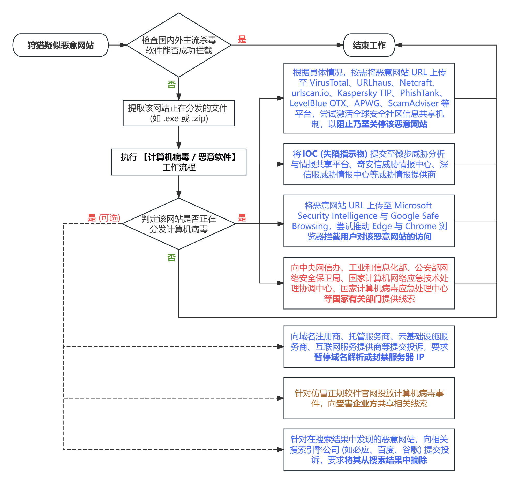

| &emsp;&emsp;&emsp;&emsp;&emsp;&emsp;&emsp;坚 持 筑 牢 国 家 网 络 安 全 屏 障&emsp;&emsp;&emsp;&emsp;&emsp;&emsp;&emsp; |
| :----------------------------------------------------------: |

| &emsp;&emsp;&emsp;&emsp;&emsp;&emsp;&emsp;没 有 网 络 安 全 就 没 有 国 家 安 全&emsp;&emsp;&emsp;&emsp;&emsp;&emsp;&emsp; |
| :----------------------------------------------------------: |

| &emsp;&emsp;&emsp;&emsp;&emsp;&emsp;&emsp;网 络 安 全 为 人 民&emsp;网 络 安 全 靠 人 民&emsp;&emsp;&emsp;&emsp;&emsp;&emsp;&emsp; |
| :----------------------------------------------------------: |

| &emsp;深 化 网 络 空 间 安 全 综 合 治 理&emsp;加 快 国 家 网 络 安 全 防 御 体 系 建 设&emsp; |
| :----------------------------------------------------------: |

<h1 align="center">灵糕中心 · 安全响应中心</h1>

<h3 align="center">Linggao Hub · Security Response Center (LGSRC)</h3>

[www.lgsrc.cn](https://www.lgsrc.cn) (门户) & [github.com/Lingggao/LGSRC](https://github.com/Lingggao/LGSRC) (GitHub)

&emsp;&emsp;**用于打击计算机病毒与恶意网站的 “[灵糕中心](https://github.com/Lingggao/LGHUB) · 安全响应中心”**。由独立网络安全研究员、中国计算机学会 (CCF) 会员兼计算机安全专业委员会委员 [**Ling Gao**](https://github.com/Lingggao/LGSRC/blob/main/Documents/Leadership.md) 领导。灵糕中心 · 安全响应中心创立于 2025 年 12 月 20 日。

> [!IMPORTANT]
>
> &emsp;灵糕中心为独立非营利组织，与其他企业不构成隶属、雇佣、代理等关系。

&emsp;&emsp;**宗旨**：独立管理、放眼全国、数据精确、打击迅速

## 工作流程

【**计算机病毒 / 恶意软件**】

---

【**恶意网站**】

---

**满足以下任一条件时，数据无需填入表格**

1. 多数杀毒软件可拦截该文件或网站，无需进行人工分析
2. 经前期分析，可 100% 确认为正常文件或网站
3. Microsoft 与 Kaspersky 安全研究员判定该文件或网站安全
4. 该文件或网站首次发现日期距今已超过 30 天
5. 由其他从业人员或志愿者发现、分析并上报，本中心全程未参与

## 数据

&emsp;&emsp;上次更新时间：2026 年 11 月 17 日 23:00 (GMT+8)

&emsp;&emsp;**截至 2026 年 11 月 17 日，本中心已打击计算机病毒 / 恶意软件 2,053 个、恶意网站 1,114 个，累计为潜在受害者规避经济损失约 8,725,250 元人民币**。[ $$E = \sum (W_i \times P_{\text{exec}} \times N_{\text{victim}} \times P_{\text{monetize}} \times V_{\text{loss}})$$ ] ([何意味？](https://github.com/Lingggao/LGSRC/blob/main/Documents/LossModel.md))

&emsp;&emsp;在对抗网络犯罪的崇高事业中，本中心仅承担了少量协调类工作。**恶意载荷从发现到清除，离不开国家有关部门、安全社区与研究员、杀毒软件厂商及威胁情报提供商的共同努力**。在此，谨向他们致以诚挚谢意。

---

&emsp;&emsp;**本中心每打击 1 个计算机病毒或恶意网站，将同步向[联合国儿童基金会](https://www.unicef.org/zh) “爱心为救灾” 计划捐赠 1 元人民币** (每月上限 230 元)。该计划旨在支持中国及其他国家实现可持续发展目标，尤其致力于为困境儿童提供援助。([捐款收据](https://github.com/Lingggao/LGSRC/blob/main/Images/%E6%8D%90%E6%AC%BE%E6%94%B6%E6%8D%AE.png))

&emsp;&emsp;2026 年 7 月 10 日，本中心通过广西慈善联合总会，向广西南宁贵港洪涝灾害受灾群众[捐赠](https://github.com/Lingggao/LGSRC/blob/main/Images/%E5%B9%BF%E8%A5%BF%E6%B4%AA%E6%B6%9D%E7%81%BE%E5%AE%B3.jpeg)人民币 2,026 元；2026 年 8 月 28 日，本中心通过上海市红十字会，向西藏吉隆泥石流灾害抢险救援工作[捐赠](https://github.com/Lingggao/LGSRC/blob/main/Images/%E8%A5%BF%E8%97%8F%E6%B3%A5%E7%9F%B3%E6%B5%81%E7%81%BE%E5%AE%B3.jpg)人民币 1,500 元。

---

【**计算机病毒 / 恶意软件**】

> [!CAUTION]
>
> &emsp;为确保安全，本中心**不提供**计算机病毒 / 恶意软件样本下载服务。

|    日期    |          文件名          |           检测           |                            SHA256                            |             Internal ID              |                          VirusTotal                          |                        MalwareBazaar                         | 编号 |
| :--------: | :----------------------: | :----------------------: | :----------------------------------------------------------: | :----------------------------------: | :----------------------------------------------------------: | :----------------------------------------------------------: | :--: |
| 2026/11/14 |     192.1.2-x64.exe      |   **银狐 (SilverFox)**   | 8ee0ce41863e81229521e81b2bec2c59d1a8dbd471629d225cf1c5d2abf71ed6 | 0358c10e-8c4d-43bc-a71b-22cb67e223c4 | [VirusTotal](https://www.virustotal.com/gui/file/8ee0ce41863e81229521e81b2bec2c59d1a8dbd471629d225cf1c5d2abf71ed6) (33) | [MalwareBazaar Database](https://bazaar.abuse.ch/sample/8ee0ce41863e81229521e81b2bec2c59d1a8dbd471629d225cf1c5d2abf71ed6) | 2034 |
| 2026/11/14 | dingtalk_downloader.exe  | **银狐 (SilverFox.ICL)** | e0cb38109715476c5db9be2fc7fb4611b93e037467b0b3c56872537b623d5ccf | 3e2a182c-869a-4f69-95ed-aee07fd0f94c | [VirusTotal](https://www.virustotal.com/gui/file/e0cb38109715476c5db9be2fc7fb4611b93e037467b0b3c56872537b623d5ccf) (27) | [MalwareBazaar Database](https://bazaar.abuse.ch/sample/e0cb38109715476c5db9be2fc7fb4611b93e037467b0b3c56872537b623d5ccf) | 2035 |
| 2026/11/14 |  Firefox Installer.exe   |   **银狐 (SilverFox)**   | 488e3b3ea5b2925057041c1d6722edfddb532cddd033adf1e6e26d9ebc51a2b1 | 6b9be2d9-62c2-4572-8dfa-b27b6ad0986a | [VirusTotal](https://www.virustotal.com/gui/file/488e3b3ea5b2925057041c1d6722edfddb532cddd033adf1e6e26d9ebc51a2b1) (27) | [MalwareBazaar Database](https://bazaar.abuse.ch/sample/488e3b3ea5b2925057041c1d6722edfddb532cddd033adf1e6e26d9ebc51a2b1) | 2036 |
| 2026/11/14 | qishui-x64-win-3.2.8.exe |   **银狐 (SilverFox)**   | ae9a4ecb05a021451afa0e4d0877e870b3eac3e1fe02e5a672bec85815dc5f3f | 135cc638-6755-4ae3-8e30-c98aca160694 | [VirusTotal](https://www.virustotal.com/gui/file/ae9a4ecb05a021451afa0e4d0877e870b3eac3e1fe02e5a672bec85815dc5f3f) (13) | [MalwareBazaar Database](https://bazaar.abuse.ch/sample/ae9a4ecb05a021451afa0e4d0877e870b3eac3e1fe02e5a672bec85815dc5f3f) | 2037 |
| 2026/11/14 |   SogouExplorer···.exe   |   **银狐 (SilverFox)**   | 226049ccea0420c6ce9cbbc9254adcd1289d4ece7c7b5349fe01831735dc87d3 | 4ab53f68-8021-407a-a8f3-0dfbb11d8f6f | [VirusTotal](https://www.virustotal.com/gui/file/226049ccea0420c6ce9cbbc9254adcd1289d4ece7c7b5349fe01831735dc87d3) (8) | [MalwareBazaar Database](https://bazaar.abuse.ch/sample/226049ccea0420c6ce9cbbc9254adcd1289d4ece7c7b5349fe01831735dc87d3) | 2038 |
| 2026/11/15 |   deepsk_x64.in.02.exe   | **银狐 (SilverFox.PHL)** | ed0bb86015e4dc6a2be018077332de961d3d6db68f75df2942f19f659d49ad6f | d6502e19-edb8-42d5-af3b-028bed32acb5 | [VirusTotal](https://www.virustotal.com/gui/file/ed0bb86015e4dc6a2be018077332de961d3d6db68f75df2942f19f659d49ad6f) (31) | [MalwareBazaar Database](https://bazaar.abuse.ch/sample/ed0bb86015e4dc6a2be018077332de961d3d6db68f75df2942f19f659d49ad6f) | 2039 |
| 2026/11/15 |   deepsk_x64.in.03.exe   | **银狐 (SilverFox.PHL)** | c03e1b034b2dc53b24a57dbe0bad2ff3d30c930f0b706edfa3ddb976707eec09 | 41b4ecb3-1d99-4b17-8657-6f0fc0b6ecf0 | [VirusTotal](https://www.virustotal.com/gui/file/c03e1b034b2dc53b24a57dbe0bad2ff3d30c930f0b706edfa3ddb976707eec09) (31) | [MalwareBazaar Database](https://bazaar.abuse.ch/sample/c03e1b034b2dc53b24a57dbe0bad2ff3d30c930f0b706edfa3ddb976707eec09) | 2040 |
| 2026/11/15 |   deepsk_x64.in.04.exe   | **银狐 (SilverFox.PHL)** | 313007053a4233d82dcf6fad81fdc4bbee2898af693101c9707b30daa7dede71 | 61add40e-5786-47a2-8721-63d9026373ec | [VirusTotal](https://www.virustotal.com/gui/file/313007053a4233d82dcf6fad81fdc4bbee2898af693101c9707b30daa7dede71) (33) | [MalwareBazaar Database](https://bazaar.abuse.ch/sample/313007053a4233d82dcf6fad81fdc4bbee2898af693101c9707b30daa7dede71) | 2041 |
| 2026/11/15 |   deepsk_x64.in.07.exe   | **银狐 (SilverFox.PHL)** | 3508ff0f60393da94291896fc95c23832322b57cf228d599911c33c493b7e7a7 | 88c27d6f-2a12-4e73-88b5-e40dc3e083fc | [VirusTotal](https://www.virustotal.com/gui/file/3508ff0f60393da94291896fc95c23832322b57cf228d599911c33c493b7e7a7) (30) | [MalwareBazaar Database](https://bazaar.abuse.ch/sample/3508ff0f60393da94291896fc95c23832322b57cf228d599911c33c493b7e7a7) | 2042 |
| 2026/11/15 |   deepsk_x64.in.13.exe   | **银狐 (SilverFox.PHL)** | bb605b6d4d91bd9cc787b6b9e40d38a16ff423bee9d3c6dacf3d70aab695690c | 8e713ece-815b-4c3c-80b1-3c1614e0b805 | [VirusTotal](https://www.virustotal.com/gui/file/bb605b6d4d91bd9cc787b6b9e40d38a16ff423bee9d3c6dacf3d70aab695690c) (30) | [MalwareBazaar Database](https://bazaar.abuse.ch/sample/bb605b6d4d91bd9cc787b6b9e40d38a16ff423bee9d3c6dacf3d70aab695690c) | 2043 |
| 2026/11/15 |   deepsk_x64.in.15.exe   | **银狐 (SilverFox.PHL)** | 201f298ad9e5940aff96ac3a165c4a4800b50cc070b945e68d98dc9b28e5831e | 8de03c9e-37d5-428a-ba12-2e6ca4969207 | [VirusTotal](https://www.virustotal.com/gui/file/201f298ad9e5940aff96ac3a165c4a4800b50cc070b945e68d98dc9b28e5831e) (32) | [MalwareBazaar Database](https://bazaar.abuse.ch/sample/201f298ad9e5940aff96ac3a165c4a4800b50cc070b945e68d98dc9b28e5831e) | 2044 |
| 2026/11/15 |  11.15ydfywondisans.exe  |   **银狐 (SilverFox)**   | 20702c4400a465a0d9935ddbcacb66d99e81c3eb90336df5f1a13d1b2a674922 | 45d86357-32fd-4bfc-93bc-7e6d8a5e5dd6 | [VirusTotal](https://www.virustotal.com/gui/file/20702c4400a465a0d9935ddbcacb66d99e81c3eb90336df5f1a13d1b2a674922) (9) | [MalwareBazaar Database](https://bazaar.abuse.ch/sample/20702c4400a465a0d9935ddbcacb66d99e81c3eb90336df5f1a13d1b2a674922) | 2045 |
| 2026/11/15 |      yoduao123.exe       |   **银狐 (SilverFox)**   | 33037dd37f1a6aae3e3ebe4a4b60a638db3a41cf73c8493f3b698b9c334c0fb5 | f3f32aaa-a40a-43cf-9596-2e04a5ff2282 | [VirusTotal](https://www.virustotal.com/gui/file/33037dd37f1a6aae3e3ebe4a4b60a638db3a41cf73c8493f3b698b9c334c0fb5) (4) | [MalwareBazaar Database](https://bazaar.abuse.ch/sample/33037dd37f1a6aae3e3ebe4a4b60a638db3a41cf73c8493f3b698b9c334c0fb5) | 2046 |
| 2026/11/15 |      Youdao_win.exe      |   **银狐 (SilverFox)**   | ccc8053c432e7bc0ab10d874e6727b9ebf411899c47af5be974e19073c4dd777 | 7b1710d4-cc99-4247-a74e-649a22d8a793 | [VirusTotal](https://www.virustotal.com/gui/file/ccc8053c432e7bc0ab10d874e6727b9ebf411899c47af5be974e19073c4dd777) (5) | [MalwareBazaar Database](https://bazaar.abuse.ch/sample/ccc8053c432e7bc0ab10d874e6727b9ebf411899c47af5be974e19073c4dd777) | 2047 |
| 2026/11/15 |      YouDaoX64.exe       |   **银狐 (SilverFox)**   | 3df036123e1ef0d0c7ef63f735f2357eb7c58e36daf091745427b999f1786ba1 | 2c0af435-b0f9-440f-80d2-3910abce148c | [VirusTotal](https://www.virustotal.com/gui/file/3df036123e1ef0d0c7ef63f735f2357eb7c58e36daf091745427b999f1786ba1) (26) | [MalwareBazaar Database](https://bazaar.abuse.ch/sample/3df036123e1ef0d0c7ef63f735f2357eb7c58e36daf091745427b999f1786ba1) | 2048 |
| 2026/11/17 |  11.17todeskaion···.exe  |   **银狐 (SilverFox)**   | 03b78f11acb60c7de3a1b42e4d2f87e9211e24ce2aea56d95079887ae8e86063 | 8c0fc211-840c-4de2-8798-ef3de1276762 | [VirusTotal](https://www.virustotal.com/gui/file/03b78f11acb60c7de3a1b42e4d2f87e9211e24ce2aea56d95079887ae8e86063) (9) | [MalwareBazaar Database](https://bazaar.abuse.ch/sample/03b78f11acb60c7de3a1b42e4d2f87e9211e24ce2aea56d95079887ae8e86063) | 2049 |
| 2026/11/17 |      ToDesk_HLL.exe      |   **银狐 (SilverFox)**   | f0f7ea2496852ac1e6756b4a1959bb3e6e488e4d3d616dfd966c2d7a512bbff0 | 28ccaafa-2281-4c15-967b-07bd0a249ced | [VirusTotal](https://www.virustotal.com/gui/file/f0f7ea2496852ac1e6756b4a1959bb3e6e488e4d3d616dfd966c2d7a512bbff0) (37) | [MalwareBazaar Database](https://bazaar.abuse.ch/sample/f0f7ea2496852ac1e6756b4a1959bb3e6e488e4d3d616dfd966c2d7a512bbff0) | 2050 |
| 2026/11/17 |      ToDesk_x64.exe      |   **银狐 (SilverFox)**   | 75b0141457f2ae16f496180b75251b95871501052e56d0c3fd3f0986c9f7b6e0 | 8cc16c02-d49b-4092-9b12-72fa82b4d61a | [VirusTotal](https://www.virustotal.com/gui/file/75b0141457f2ae16f496180b75251b95871501052e56d0c3fd3f0986c9f7b6e0) (3) | [MalwareBazaar Database](https://bazaar.abuse.ch/sample/75b0141457f2ae16f496180b75251b95871501052e56d0c3fd3f0986c9f7b6e0) | 2051 |
| 2026/11/17 |   Todesk_x64_2.1.3.exe   |   **银狐 (SilverFox)**   | 4d7101187d6ebd723509d6ec9de589c4ceea3b27ce1f43474c1d4db0def91349 | 64fe77b8-2212-45f8-8751-6204ee55c9d0 | [VirusTotal](https://www.virustotal.com/gui/file/4d7101187d6ebd723509d6ec9de589c4ceea3b27ce1f43474c1d4db0def91349) (29) | [MalwareBazaar Database](https://bazaar.abuse.ch/sample/4d7101187d6ebd723509d6ec9de589c4ceea3b27ce1f43474c1d4db0def91349) | 2052 |
| 2026/11/17 |   todesk-x64.10.05.msi   |   **银狐 (SilverFox)**   | 13d5f721a2da5c935e511147a4c0e498d18aa53249420bce54cd72b206f3d589 | 35baa165-7b66-4417-90ec-be54e70c3b7e | [VirusTotal](https://www.virustotal.com/gui/file/13d5f721a2da5c935e511147a4c0e498d18aa53249420bce54cd72b206f3d589) (18) | [MalwareBazaar Database](https://bazaar.abuse.ch/sample/13d5f721a2da5c935e511147a4c0e498d18aa53249420bce54cd72b206f3d589) | 2053 |
|   ——————   |       ————————————       |       ————————————       |             ———————————————————————————————————              |         ————————————————————         |                           ————————                           |                         ————————————                         | ———  |

> [!NOTE]
>
> &emsp;只显示最近 20 条数据，更早数据详见 LGSRC/[Archive_1.md](https://github.com/Lingggao/LGSRC/blob/main/Archive_1.md) (计算机病毒 / 恶意软件归档)。

---

【**恶意网站**】

> [!CAUTION]
>
> &emsp;为确保安全，网站地址将用 “hxxps://” 与 “[.]” 进行替换。**切勿尝试访问表格中列出的任何网址**。

|    日期    |                   URL                   |            类别            |                           有效载荷                           |                         URLhaus                          | 编号 |
| :--------: | :-------------------------------------: | :------------------------: | :----------------------------------------------------------: | :------------------------------------------------------: | :--: |
| 2026/11/13 |      hxxps://sunlogin-remote[.]cn       |  **仿冒向日葵、传播病毒**  |     hxxps://v2raynapps[.]com[.]cn/xrkAwe_Sun16[.]6[.]zip     | [URLhaus Database](https://urlhaus.abuse.ch/url/4065139) | 1095 |
| 2026/11/13 |       hxxps://sunlogin-app[.]com        |  **仿冒向日葵、传播病毒**  |                           同 1093                            |                            无                            | 1096 |
| 2026/11/13 |       hxxps://sunlogin-app[.]net        |  **仿冒向日葵、传播病毒**  |                           同 1093                            |                            无                            | 1097 |
| 2026/11/15 |         hxxps://youdaoweb[.]com         | **仿冒有道翻译、传播病毒** |                    hxxps://youdaopc[.]com                    |                            无                            | 1098 |
| 2026/11/15 |         hxxps://youdaopc[.]com          | **仿冒有道翻译、传播病毒** | hxxps://windo[.]oss-cn-hongkong[.]aliyuncs[.]com/Youdao_win[.]zip | [URLhaus Database](https://urlhaus.abuse.ch/url/4066831) | 1099 |
| 2026/11/15 |      hxxps://www[.]youdaofyi[.]com      | **仿冒有道翻译、传播病毒** |    hxxps://wwce[.]hellowortnm[.]cn/youdao/yoduao123[.]zip    | [URLhaus Database](https://urlhaus.abuse.ch/url/4066833) | 1100 |
| 2026/11/15 |    hxxps://new[.]youdaoo[.]com[.]cn     | **仿冒有道翻译、传播病毒** |        (随机跳转) hxxps://188web[.]cdn-youdao[.]cn 等        |                            无                            | 1101 |
| 2026/11/15 |    hxxps://188web[.]cdn-youdao[.]cn     | **仿冒有道翻译、传播病毒** | hxxps://pub-423927d9b82649c681bc5899c6177996[.]r2[.]dev/11[.]15ydfywondisans9[.]zip | [URLhaus Database](https://urlhaus.abuse.ch/url/4066829) | 1102 |
| 2026/11/15 |    hxxps://2871web[.]cdn-youdao[.]cn    | **仿冒有道翻译、传播病毒** |  同 1102，仅在必应搜索结果中点击该链接时才会跳转至恶意网站   |                            无                            | 1103 |
| 2026/11/15 |      hxxps://edo[.]youdaogf[.]com       | **仿冒有道翻译、传播病毒** | hxxps://guanfangxiazai-oss-cn-singapore-aliyuncs[.]top/YouDaoX64[.]zip | [URLhaus Database](https://urlhaus.abuse.ch/url/4066832) | 1104 |
| 2026/11/15 |     hxxps://p[.]youdaofanyigw[.]com     | **仿冒有道翻译、传播病毒** |                           同 1104                            |                            无                            | 1105 |
| 2026/11/15 |    hxxps://ssl[.]youdaofanyigf[.]com    | **仿冒有道翻译、传播病毒** |                           同 1104                            |                            无                            | 1106 |
| 2026/11/17 |        hxxps://app-todesk[.]com         | **仿冒 ToDesk、传播病毒**  |                       有，载荷提取失败                       |                            无                            | 1107 |
| 2026/11/17 |        hxxps://todesk[.]cn[.]com        | **仿冒 ToDesk、传播病毒**  | hxxps://hll912-1484535448[.]cos[.]ap-hongkong[.]myqcloud[.]com/ToDesk_HLL%20[.]zip |                            无                            | 1108 |
| 2026/11/17 |     hxxps://oa[.]todeak[.]com[.]cn      | **仿冒 ToDesk、传播病毒**  |     (随机跳转) hxxps://581web[.]cdn-todesk[.]com[.]cn 等     |                            无                            | 1109 |
| 2026/11/17 | hxxps://581web[.]cdn-todesk[.]com[.]cn  | **仿冒 ToDesk、传播病毒**  | hxxps://pub-c2333fd98ad04e31be785553c40467a4[.]r2[.]dev/11[.]17todeskaioniuawcwq[.]zip |                            无                            | 1110 |
| 2026/11/17 | hxxps://2786web[.]cdn-todesk[.]com[.]cn | **仿冒 ToDesk、传播病毒**  |  同 1110，仅在必应搜索结果中点击该链接时才会跳转至恶意网站   |                            无                            | 1111 |
| 2026/11/17 |     hxxps://todesk-peak[.]com[.]cn      | **仿冒 ToDesk、传播病毒**  | hxxps://pub-8c944cde37db4a589e86137d049091b0[.]r2[.]dev/Aliyrne-s3/Lmynrewb/todesk-x64[.]10[.]05[.]zip |                            无                            | 1112 |
| 2026/11/17 |     hxxps://todesk-nova[.]com[.]cn      | **仿冒 ToDesk、传播病毒**  |                           同 1112                            |                            无                            | 1113 |
| 2026/11/17 |   hxxps://api[.]apptodask[.]com[.]cn    | **仿冒 ToDesk、传播病毒**  | hxxps://dashijie2026[.]oss-ap-southeast-7[.]aliyuncs[.]com/Todesk_x64_2[.]1[.]3[.]zip |                            无                            | 1114 |
|   ——————   |          ————————————————————           |      ———————————————       |                ——————————————————————————————                |                        ——————————                        | ———  |

> [!NOTE]
>
> &emsp;只显示最近 20 条数据，更早数据详见 LGSRC/[Archive_2.md](https://github.com/Lingggao/LGSRC/blob/main/Archive_2.md) (恶意网站归档)。
>
> &emsp;暂时无暇核实与处理的疑似恶意网站详见 LGSRC/[Archive_3.md](https://github.com/Lingggao/LGSRC/blob/main/Archive_3.md) (仅记录，未核实且未打击)。

## 交流与合作

&emsp;&emsp;[**LGSRC 管理委员会**](https://github.com/Lingggao/LGSRC/blob/main/Documents/Leadership.md)

&emsp;&emsp;如需联系 Ling Gao，请发送电子邮件至 ling@lghub.org 或 ling_gao@acm.org。谢谢！🥰

&emsp;&emsp;如需本中心协助检测**文件**是否存在恶意行为，请将其上传至[微步云沙箱](https://s.threatbook.com)及 [VirusTotal](https://www.virustotal.com)，并将 **SHA256** 填入[本表单](https://forms.cloud.microsoft/Pages/ResponsePage.aspx?id=39DabECOEk2JZekK_Z5UjJJAHDqug_FNgSvl5TTF-MJUM1pISDk0VTFLNjhHVVpJQ0FHVDlLMjcwMi4u) (请勿直接发送文件本体)；如需本中心协助检测**网站**是否存在恶意行为，请将 **URL** 填入[本表单](https://forms.cloud.microsoft/Pages/ResponsePage.aspx?id=39DabECOEk2JZekK_Z5UjJJAHDqug_FNgSvl5TTF-MJUM1pISDk0VTFLNjhHVVpJQ0FHVDlLMjcwMi4u)。同时，请提供您的**电子邮件地址**。本中心将独立进行分析，并于 2 个工作日内将检测结果发送至您填写的邮箱。上传至第三方平台前，请仔细阅读相关服务条款与隐私政策，并确保文件与网站中不含任何个人信息。

---

&emsp;&emsp;[**恶意软件研究工具集**](https://github.com/Lingggao/LGSRC/blob/main/Documents/Toolkit.md)

&emsp;&emsp;[《**工作成效报告**》](https://github.com/Lingggao/LGSRC/blob/main/Documents/Impact.md) (二〇二六年十月)

&emsp;&emsp;[《**常被 “银狐” 犯罪团伙仿冒的软件列表及注意事项**》](https://github.com/Lingggao/LGSRC/blob/main/Documents/List.md) (已收录 111 款软件)

&emsp;&emsp;[《**“银狐” 威胁动态：官方及网络安全企业文章汇编**》](https://github.com/Lingggao/LGSRC/blob/main/Documents/SilverFox_Articles.md) (已收录 47 篇文章)

&emsp;&emsp;**银狐 IOC 情报合集**：[**VirusTotal**](https://www.virustotal.com/gui/collection/c4dd0a03e18770678ba094169aa006095d3a0cbda29587567507f8d956db38e1) + [**LevelBlue OTX**](https://otx.alienvault.com/pulse/6a36fe5a3c1568785b59c4d7) (已收录 2,434 项情报，实时更新)

## 人工智能 (AI)

- AI Agent 技能：[**vt-insight**](https://github.com/Lingggao/LGSRC/blob/main/vt-insight/SKILL.md)
- DeepSeek Harness 插件：[**threatbook-intel**](https://github.com/Lingggao/LGSRC/tree/main/dsh-plugins/threatbook-intel)

&emsp;&emsp;欢迎体验我们编写的 **AI Agent** 技能 [**vt-insight**](https://github.com/Lingggao/LGSRC/blob/main/vt-insight/SKILL.md)！该技能可用于在 VirusTotal 网站查询样本信息，自动整理并格式化输出查询报告。([效果图 ①](https://github.com/Lingggao/LGSRC/blob/main/Images/Rendering%201.png)) ([效果图 ②](https://github.com/Lingggao/LGSRC/blob/main/Images/Rendering%202.png)) 向 AI 大模型发送指令 `“将此 .md 文档作为 Skill 安装：https://github.com/Lingggao/LGSRC/blob/main/vt-insight/SKILL.md，安装成功后作简要介绍。”` 即可安装此技能，前往[**微步 Skill 广场**](https://x.threatbook.com/v5/skill/58eeb86ccd5fc240e8e04a24520e6158)或 [ClawHub](https://clawhub.ai/lingggao/vt-insight) 安装亦可。([vt-insight 技能安全审计报告](https://github.com/Lingggao/LGSRC/blob/main/Documents/vt-insight-security-audit-report%20(%E8%85%BE%E8%AE%AF%E5%AE%89%E5%85%A8%E4%BA%91%E9%BC%8E%E5%AE%9E%E9%AA%8C%E5%AE%A4).md)) ([微步 SafeSkill 检测报告](https://safeskill.cn/report/3bd851387126652d775c0a5e42fa60051b1ca16e6cad7c9b3088e89b09105a2b))

&emsp;&emsp;欢迎体验我们制作的 **DeepSeek Harness** 插件 [**threatbook-intel**](https://github.com/Lingggao/LGSRC/tree/main/dsh-plugins/threatbook-intel)！该插件可用于在 DSH 界面绑定微步 X 情报中心 API Key，输入文件 Hash、URL、域名、IP 等进行情报查询，支持 AI 总结与报告本地保存。([效果图 ①](https://github.com/Lingggao/LGSRC/blob/main/Images/Rendering%203.png)) ([效果图 ②](https://github.com/Lingggao/LGSRC/blob/main/Images/Rendering%204.png)) ([效果图 ③](https://github.com/Lingggao/LGSRC/blob/main/Images/Rendering%205.png)) 前往[**发布页**](https://github.com/Lingggao/LGSRC/releases)下载最新版本 `threatbook-intel-(版本号).zip` 安装包，解压后在 DSH 中点击 `“插件” > “添加插件”`，填入解压路径即可安装此插件。([threatbook-intel 插件安全自检报告](https://github.com/Lingggao/LGSRC/blob/main/dsh-plugins/docs/threatbook-intel-security-audit.md))

---

[回到顶部](#HEAD)

  

在 “[署名 - 相同方式共享 4.0](https://creativecommons.org/licenses/by-sa/4.0/legalcode.zh-Hans)” (CC BY-SA 4.0) 协议之条款下提供。

2025 - 2026, [Ling Gao](https://github.com/Lingggao/LGSRC/blob/main/Documents/Leadership.md), 灵糕中心 · 安全响应中心, [github.com/Lingggao/LGSRC](https://github.com/Lingggao/LGSRC)