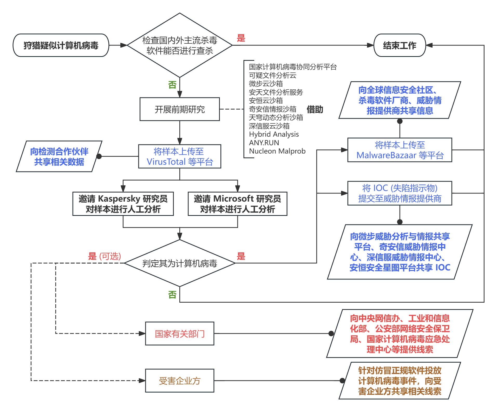
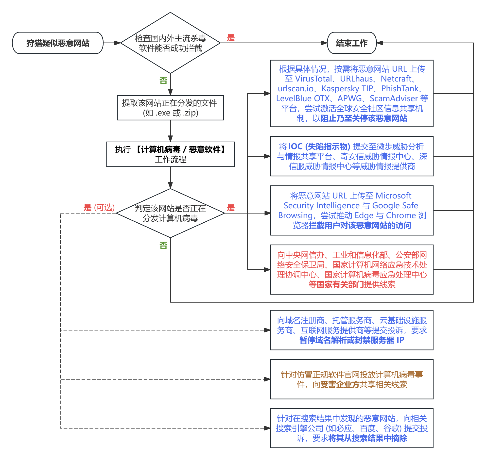

| &emsp;&emsp;&emsp;&emsp;&emsp;&emsp;&emsp;坚 持 筑 牢 国 家 网 络 安 全 屏 障&emsp;&emsp;&emsp;&emsp;&emsp;&emsp;&emsp; |
| :----------------------------------------------------------: |

| &emsp;&emsp;&emsp;&emsp;&emsp;&emsp;&emsp;没 有 网 络 安 全 就 没 有 国 家 安 全&emsp;&emsp;&emsp;&emsp;&emsp;&emsp;&emsp; |
| :----------------------------------------------------------: |

| &emsp;&emsp;&emsp;&emsp;&emsp;&emsp;&emsp;网 络 安 全 为 人 民&emsp;网 络 安 全 靠 人 民&emsp;&emsp;&emsp;&emsp;&emsp;&emsp;&emsp; |
| :----------------------------------------------------------: |

| &emsp;深 化 网 络 空 间 安 全 综 合 治 理&emsp;加 快 国 家 网 络 安 全 防 御 体 系 建 设&emsp; |
| :----------------------------------------------------------: |

<h1 align="center">灵糕中心 · 安全响应中心</h1>

<h3 align="center">Linggao Hub · Security Response Center (LGSRC)</h3>

[www.lgsrc.cn](https://www.lgsrc.cn) (门户) & [github.com/Lingggao/LGSRC](https://github.com/Lingggao/LGSRC) (GitHub)

&emsp;&emsp;**用于打击计算机病毒与恶意网站的 “[灵糕中心](https://github.com/Lingggao/LGHUB) · 安全响应中心”**。由独立网络安全研究员、中国计算机学会 (CCF) 会员兼计算机安全专业委员会委员 [**Ling Gao**](https://github.com/Lingggao/LGSRC/blob/main/Documents/Leadership.md) 领导。灵糕中心 · 安全响应中心创立于 2025 年 12 月 20 日。

> [!IMPORTANT]
>
> &emsp;灵糕中心为独立非营利组织，与其他企业不构成隶属、雇佣、代理等关系。

&emsp;&emsp;**宗旨**：独立管理、放眼全国、数据精确、打击迅速

## 工作流程

【**计算机病毒 / 恶意软件**】

---

【**恶意网站**】

---

**满足以下任一条件时，数据无需填入表格**

1. 多数杀毒软件可拦截该文件或网站，无需进行人工分析
2. 经前期分析，可 100% 确认为正常文件或网站
3. Microsoft 与 Kaspersky 安全研究员判定该文件或网站安全
4. 该文件或网站首次发现日期距今已超过 30 天
5. 由其他从业人员或志愿者发现、分析并上报，本中心全程未参与

## 数据

&emsp;&emsp;上次更新时间：2026 年 10 月 28 日 22:00 (GMT+8)

&emsp;&emsp;**截至 2026 年 10 月 28 日，本中心已打击计算机病毒 / 恶意软件 1,960 个、恶意网站 1,023 个，累计为潜在受害者规避经济损失约 8,330,000 元人民币**。[ $$E = \sum (W_i \times P_{\text{exec}} \times N_{\text{victim}} \times P_{\text{monetize}} \times V_{\text{loss}})$$ ] ([何意味？](https://github.com/Lingggao/LGSRC/blob/main/Documents/LossModel.md))

&emsp;&emsp;在对抗网络犯罪的崇高事业中，本中心仅承担了少量协调类工作。**恶意载荷从发现到清除，离不开国家有关部门、安全社区与研究员、杀毒软件厂商及威胁情报提供商的共同努力**。在此，谨向他们致以诚挚谢意。

---

&emsp;&emsp;**本中心每打击 1 个计算机病毒或恶意网站，将同步向[联合国儿童基金会](https://www.unicef.org/zh) “爱心为救灾” 计划捐赠 1 元人民币** (每月上限 230 元)。该计划旨在支持中国及其他国家实现可持续发展目标，尤其致力于为困境儿童提供援助。([捐款收据](https://github.com/Lingggao/LGSRC/blob/main/Images/%E6%8D%90%E6%AC%BE%E6%94%B6%E6%8D%AE.png))

&emsp;&emsp;2026 年 7 月 10 日，本中心通过广西慈善联合总会，向广西南宁贵港洪涝灾害受灾群众[捐赠](https://github.com/Lingggao/LGSRC/blob/main/Images/%E5%B9%BF%E8%A5%BF%E6%B4%AA%E6%B6%9D%E7%81%BE%E5%AE%B3.jpeg)人民币 2,026 元；2026 年 8 月 28 日，本中心通过上海市红十字会，向西藏吉隆泥石流灾害抢险救援工作[捐赠](https://github.com/Lingggao/LGSRC/blob/main/Images/%E8%A5%BF%E8%97%8F%E6%B3%A5%E7%9F%B3%E6%B5%81%E7%81%BE%E5%AE%B3.jpg)人民币 1,500 元。

---

【**计算机病毒 / 恶意软件**】

> [!CAUTION]
>
> &emsp;为确保安全，本中心**不提供**计算机病毒 / 恶意软件样本下载服务。

|    日期    |        文件名         |           检测           |                            SHA256                            |             Internal ID              |                          VirusTotal                          |                        MalwareBazaar                         | 编号 |
| :--------: | :-------------------: | :----------------------: | :----------------------------------------------------------: | :----------------------------------: | :----------------------------------------------------------: | :----------------------------------------------------------: | :--: |
| 2026/10/23 |  install.2.0.06.exe   | **银狐 (SilverFox.PHL)** | 243c526b8b42f252bcdc20a0b6494b66fdf5fb3a5a1f9c913c463f02739bc6a3 | 0d5aecbe-41e7-4836-a20f-665ef1b6690a | [VirusTotal](https://www.virustotal.com/gui/file/243c526b8b42f252bcdc20a0b6494b66fdf5fb3a5a1f9c913c463f02739bc6a3) (19) | [MalwareBazaar Database](https://bazaar.abuse.ch/sample/243c526b8b42f252bcdc20a0b6494b66fdf5fb3a5a1f9c913c463f02739bc6a3) | 1941 |
| 2026/10/24 |  install.2.0.04.exe   | **银狐 (SilverFox.PHL)** | 7fae9dca21c5c2f802c1a48c707abeecd41feb3b18b828ca4fce1f5333d3f645 | dd22718f-6e24-463e-814f-bb45e74d0e2c | [VirusTotal](https://www.virustotal.com/gui/file/7fae9dca21c5c2f802c1a48c707abeecd41feb3b18b828ca4fce1f5333d3f645) (20) | [MalwareBazaar Database](https://bazaar.abuse.ch/sample/7fae9dca21c5c2f802c1a48c707abeecd41feb3b18b828ca4fce1f5333d3f645) | 1942 |
| 2026/10/24 |  install.2.0.05.exe   | **银狐 (SilverFox.PHL)** | b9b4bdac7ed3c88a3bfe335439dd07594b9bf913e1b8f8e72b4018acc1e1c837 | 13c41144-304e-4354-aebc-2a703b0ba9d8 | [VirusTotal](https://www.virustotal.com/gui/file/b9b4bdac7ed3c88a3bfe335439dd07594b9bf913e1b8f8e72b4018acc1e1c837) (19) | [MalwareBazaar Database](https://bazaar.abuse.ch/sample/b9b4bdac7ed3c88a3bfe335439dd07594b9bf913e1b8f8e72b4018acc1e1c837) | 1943 |
| 2026/10/24 |  install.2.0.06.exe   | **银狐 (SilverFox.PHL)** | 2b9ea6388458cf38b7a152a213b4b93fbd9114d4c3580c12eb2b2db6cf4b07d2 | 9adee450-8b80-43ee-a571-329e7bf6e7c5 | [VirusTotal](https://www.virustotal.com/gui/file/2b9ea6388458cf38b7a152a213b4b93fbd9114d4c3580c12eb2b2db6cf4b07d2) (18) | [MalwareBazaar Database](https://bazaar.abuse.ch/sample/2b9ea6388458cf38b7a152a213b4b93fbd9114d4c3580c12eb2b2db6cf4b07d2) | 1944 |
| 2026/10/26 |   207.56.28.205.exe   |   **银狐 (SilverFox)**   | f942bf7c88e04cf158a6541a5ba60ee856ef34144a00f1c4fadbbde650845672 | 68a9ae0b-72cc-4b23-9518-b9f703f38e6c | [VirusTotal](https://www.virustotal.com/gui/file/f942bf7c88e04cf158a6541a5ba60ee856ef34144a00f1c4fadbbde650845672) (24) | [MalwareBazaar Database](https://bazaar.abuse.ch/sample/f942bf7c88e04cf158a6541a5ba60ee856ef34144a00f1c4fadbbde650845672) | 1945 |
| 2026/10/26 | clash-verge-sever.exe |   **银狐 (SilverFox)**   | 2fa2dbb71878f4f3fbc3527ee3ac2a66b3322ea4f31baccc2f27c60e30e1a1ba | 2a285f1d-b513-4005-9030-497847df1549 | [VirusTotal](https://www.virustotal.com/gui/file/2fa2dbb71878f4f3fbc3527ee3ac2a66b3322ea4f31baccc2f27c60e30e1a1ba) (6) | [MalwareBazaar Database](https://bazaar.abuse.ch/sample/2fa2dbb71878f4f3fbc3527ee3ac2a66b3322ea4f31baccc2f27c60e30e1a1ba) | 1946 |
| 2026/10/26 | Letsvpnkaulian···.exe |   **银狐 (SilverFox)**   | 205544cf98cadd91f017c29a89381e1280107e1830c6ab3a3fe2f9617fcf5795 | f7e4e1eb-7c1d-4965-8aef-1fdd0f9b9c55 | [VirusTotal](https://www.virustotal.com/gui/file/205544cf98cadd91f017c29a89381e1280107e1830c6ab3a3fe2f9617fcf5795) (14) |                              无                              | 1947 |
| 2026/10/27 | BraveBrowserSetup.exe |   **银狐 (SilverFox)**   | 8264fe8ef55770bf4f20771439420c4a9228c6172970057cabe14ebca1ab4381 | 2122649b-806f-432c-8aa7-9448d251fff9 | [VirusTotal](https://www.virustotal.com/gui/file/8264fe8ef55770bf4f20771439420c4a9228c6172970057cabe14ebca1ab4381) (26) | [MalwareBazaar Database](https://bazaar.abuse.ch/sample/8264fe8ef55770bf4f20771439420c4a9228c6172970057cabe14ebca1ab4381) | 1948 |
| 2026/10/27 |  install.2.0.11.exe   | **银狐 (SilverFox.PHL)** | 8014091cc2085f085f04573d1899edb2956c739c1557451dcdd49dc7a8c139c1 | 5242a9de-0d64-4fa5-9c03-e2e3eab180bf | [VirusTotal](https://www.virustotal.com/gui/file/8014091cc2085f085f04573d1899edb2956c739c1557451dcdd49dc7a8c139c1) (37) | [MalwareBazaar Database](https://bazaar.abuse.ch/sample/8014091cc2085f085f04573d1899edb2956c739c1557451dcdd49dc7a8c139c1) | 1949 |
| 2026/10/27 |  install.2.0.12.exe   | **银狐 (SilverFox.PHL)** | 0029e6dc9619ba7593d0449efa5703ab186acdc5b9029f905a363979966fe174 | 962c9c62-0c07-4114-87ed-5f9f7b0da6bf | [VirusTotal](https://www.virustotal.com/gui/file/0029e6dc9619ba7593d0449efa5703ab186acdc5b9029f905a363979966fe174) (39) | [MalwareBazaar Database](https://bazaar.abuse.ch/sample/0029e6dc9619ba7593d0449efa5703ab186acdc5b9029f905a363979966fe174) | 1950 |
| 2026/10/27 |  install.3.1.05.exe   | **银狐 (SilverFox.PHL)** | ac60576384bed060038722a50cec6a927a37fcf092a9a5b9a4292d34753e2f56 | 24b8fe0f-d88b-432e-bc9e-c37999270727 | [VirusTotal](https://www.virustotal.com/gui/file/ac60576384bed060038722a50cec6a927a37fcf092a9a5b9a4292d34753e2f56) (23) | [MalwareBazaar Database](https://bazaar.abuse.ch/sample/ac60576384bed060038722a50cec6a927a37fcf092a9a5b9a4292d34753e2f56) | 1951 |
| 2026/10/27 |  install.3.1.06.exe   | **银狐 (SilverFox.PHL)** | d550d17c09c15fe0589c23518bb59a94e56e566ec2f3d5d266903667a47b9ca1 | ae9be3d6-4f3a-4ad3-933d-0ce208386e7d | [VirusTotal](https://www.virustotal.com/gui/file/d550d17c09c15fe0589c23518bb59a94e56e566ec2f3d5d266903667a47b9ca1) (25) | [MalwareBazaar Database](https://bazaar.abuse.ch/sample/d550d17c09c15fe0589c23518bb59a94e56e566ec2f3d5d266903667a47b9ca1) | 1952 |
| 2026/10/27 |        81.exe         |   **银狐 (SilverFox)**   | 8af3048d23ce6f0e2a6aac0972eaf42986dbb0964d0f198f8094d174a7d919e9 | d7e3341f-203a-429a-99d0-b5466117751e | [VirusTotal](https://www.virustotal.com/gui/file/8af3048d23ce6f0e2a6aac0972eaf42986dbb0964d0f198f8094d174a7d919e9) (9) | [MalwareBazaar Database](https://bazaar.abuse.ch/sample/8af3048d23ce6f0e2a6aac0972eaf42986dbb0964d0f198f8094d174a7d919e9) | 1953 |
| 2026/10/27 |  install.3.1.03.exe   | **银狐 (SilverFox.PHL)** | a9e2c1b5e9278335d4099ec20e91cda9cdc1b46b41f6c8063f7508966ad12db2 | e4950515-09df-4c35-84e3-5b3f83e99a42 | [VirusTotal](https://www.virustotal.com/gui/file/a9e2c1b5e9278335d4099ec20e91cda9cdc1b46b41f6c8063f7508966ad12db2) (25) | [MalwareBazaar Database](https://bazaar.abuse.ch/sample/a9e2c1b5e9278335d4099ec20e91cda9cdc1b46b41f6c8063f7508966ad12db2) | 1954 |
| 2026/10/27 |  install.3.1.04.exe   | **银狐 (SilverFox.PHL)** | 82b1dd14b929eb878b7ada1b94e9ecfd3e6de64cf4d9e7a9aeeb5fb34a50a62a | 09d511eb-20e5-48fc-b975-91d440a5e314 | [VirusTotal](https://www.virustotal.com/gui/file/82b1dd14b929eb878b7ada1b94e9ecfd3e6de64cf4d9e7a9aeeb5fb34a50a62a) (23) | [MalwareBazaar Database](https://bazaar.abuse.ch/sample/82b1dd14b929eb878b7ada1b94e9ecfd3e6de64cf4d9e7a9aeeb5fb34a50a62a) | 1955 |
| 2026/10/28 |  install.3.1.02.exe   | **银狐 (SilverFox.PHL)** | ee732d2f6cb929ad5e35dcd8ad3f075f30227e55f1194e6fb02030faef04635b | 1c022477-0767-4b0c-b5c6-0de7b3158a9d | [VirusTotal](https://www.virustotal.com/gui/file/ee732d2f6cb929ad5e35dcd8ad3f075f30227e55f1194e6fb02030faef04635b) (21) | [MalwareBazaar Database](https://bazaar.abuse.ch/sample/ee732d2f6cb929ad5e35dcd8ad3f075f30227e55f1194e6fb02030faef04635b) | 1956 |
| 2026/10/28 |  install.3.1.05.exe   | **银狐 (SilverFox.PHL)** | 839e5ff5a8cc705ac4c11cba1bb671b9cc5d9ff718ed514644cb8b6c06ab7b4a | 945a519b-be2d-4772-a2bc-853038ef798a | [VirusTotal](https://www.virustotal.com/gui/file/839e5ff5a8cc705ac4c11cba1bb671b9cc5d9ff718ed514644cb8b6c06ab7b4a) (24) | [MalwareBazaar Database](https://bazaar.abuse.ch/sample/839e5ff5a8cc705ac4c11cba1bb671b9cc5d9ff718ed514644cb8b6c06ab7b4a) | 1957 |
| 2026/10/28 | quark-windows···.exe  |   **银狐 (SilverFox)**   | 850d135d3ff871f88c96e5a6b889b1f454944ffdd35b2fce5e3fa1d049d8bf70 | 1ec84892-faa7-4f5a-bea5-a2983399330e | [VirusTotal](https://www.virustotal.com/gui/file/850d135d3ff871f88c96e5a6b889b1f454944ffdd35b2fce5e3fa1d049d8bf70) (15) | [MalwareBazaar Database](https://bazaar.abuse.ch/sample/850d135d3ff871f88c96e5a6b889b1f454944ffdd35b2fce5e3fa1d049d8bf70) | 1958 |
| 2026/10/28 | 10.28BTlwqnein···.exe |   **银狐 (SilverFox)**   | 31be981f647d9c14087b1b44e0a3c652d40583fb6eb93fa4ee0950261f55abf7 | 10507090-f68d-4658-9e12-caa2357d56b7 | [VirusTotal](https://www.virustotal.com/gui/file/31be981f647d9c14087b1b44e0a3c652d40583fb6eb93fa4ee0950261f55abf7) (8) |                              无                              | 1959 |
| 2026/10/28 |  bitbrowser5-x64.exe  |   **银狐 (SilverFox)**   | 6514e03252d720dd9ce9ae2eb1adf96b9bb8a5228ab9cc0319f1ef4fc66bf653 | ea2e4417-de9e-485d-8547-919fc2f0ba85 | [VirusTotal](https://www.virustotal.com/gui/file/6514e03252d720dd9ce9ae2eb1adf96b9bb8a5228ab9cc0319f1ef4fc66bf653) (2) |                              无                              | 1960 |
|   ——————   |     ————————————      |       ————————————       |             ———————————————————————————————————              |         ————————————————————         |                           ————————                           |                         ————————————                         | ———  |

> [!NOTE]
>
> &emsp;只显示最近 20 条数据，更早数据详见 LGSRC/[Archive_1.md](https://github.com/Lingggao/LGSRC/blob/main/Archive_1.md) (计算机病毒 / 恶意软件归档)。

---

【**恶意网站**】

> [!CAUTION]
>
> &emsp;为确保安全，网站地址将用 “hxxps://” 与 “[.]” 进行替换。**切勿尝试访问表格中列出的任何网址**。

|    日期    |                URL                 |              类别               |                           有效载荷                           |                         URLhaus                          | 编号 |
| :--------: | :--------------------------------: | :-----------------------------: | :----------------------------------------------------------: | :------------------------------------------------------: | :--: |
| 2026/10/27 |     hxxps://brave-browser[.]co     | **仿冒 Brave 浏览器、传播病毒** |     hxxps://app[.]appdowsdy[.]xyz/p21/BraveBrowser[.]zip     | [URLhaus Database](https://urlhaus.abuse.ch/url/4035511) | 1004 |
| 2026/10/27 |       hxxps://bravezh[.]com        | **仿冒 Brave 浏览器、传播病毒** |                           同 1004                            |                            无                            | 1005 |
| 2026/10/27 |     hxxps://apps-braveen[.]com     | **仿冒 Brave 浏览器、传播病毒** |                           同 1004                            |                            无                            | 1006 |
| 2026/10/27 |  hxxps://www[.]owr4u[.]com/lod25   |        **传播银狐病毒**         |                       有，载荷提取失败                       | [URLhaus Database](https://urlhaus.abuse.ch/url/4035551) | 1007 |
| 2026/10/27 |    hxxps://tbtool-xb[.]com[.]cn    |  **仿冒图吧工具箱、传播病毒**   |                           同 1007                            |                            无                            | 1008 |
| 2026/10/27 |     hxxps://tbtoolr[.]com[.]cn     |  **仿冒图吧工具箱、传播病毒**   |                           同 1007                            |                            无                            | 1009 |
| 2026/10/27 |    hxxps://tbtool-yc[.]com[.]cn    |  **仿冒图吧工具箱、传播病毒**   |                           同 1007                            |                            无                            | 1010 |
| 2026/10/27 |  hxxps://www[.]gun731[.]com/lod27  |        **传播银狐病毒**         |                       有，载荷提取失败                       |                            无                            | 1011 |
| 2026/10/27 |    hxxps://doubao-h[.]com[.]cn     |    **仿冒豆包 AI、传播病毒**    |                           同 1011                            |                            无                            | 1012 |
| 2026/10/27 |    hxxps://doubao-cu[.]com[.]cn    |    **仿冒豆包 AI、传播病毒**    |                           同 1011                            |                            无                            | 1013 |
| 2026/10/27 |   hxxps://doubao-cib[.]com[.]cn    |    **仿冒豆包 AI、传播病毒**    |                           同 1011                            |                            无                            | 1014 |
| 2026/10/27 |     hxxps://dioubao[.]com[.]cn     |    **仿冒豆包 AI、传播病毒**    | hxxps://aass1122[.]tos-cn-beijing[.]volces[.]com/Dssiookle_setup[.]zip | [URLhaus Database](https://urlhaus.abuse.ch/url/4036088) | 1015 |
| 2026/10/27 |  hxxps://do[.]doubaor[.]com[.]cn   |    **仿冒豆包 AI、传播病毒**    |  同 1015，仅在必应搜索结果中点击该链接时才会跳转至恶意网站   |                            无                            | 1016 |
| 2026/10/27 |  hxxps://cn[.]doubaol[.]com[.]cn   |    **仿冒豆包 AI、传播病毒**    |  同 1015，仅在必应搜索结果中点击该链接时才会跳转至恶意网站   |                            无                            | 1017 |
| 2026/10/27 | hxxps://www[.]doubao-go[.]com[.]cn |    **仿冒豆包 AI、传播病毒**    |  同 1015，仅在必应搜索结果中点击该链接时才会跳转至恶意网站   |                            无                            | 1018 |
| 2026/10/28 | hxxps://pro[.]bitehttp[.]com[.]cn  |  **仿冒比特浏览器、传播病毒**   | hxxps://pub-deebd68623a947eebf94757bdf8f090b[.]r2[.]dev/10[.]28BTlwqneinniqefacmdmeo[.]zip |                            无                            | 1019 |
| 2026/10/28 |    hxxps://bitbrowser[.]sh[.]cn    |  **仿冒比特浏览器、传播病毒**   | hxxps://bitbrowse[.]oss-cn-hongkong[.]aliyuncs[.]com/bitbrowser5-x64[.]zip |                            无                            | 1020 |
| 2026/10/28 |    hxxps://bitbrowser[.]fj[.]cn    |  **仿冒比特浏览器、传播病毒**   |                           同 1020                            |                            无                            | 1021 |
| 2026/10/28 |    hxxps://bitbrowser[.]bj[.]cn    |  **仿冒比特浏览器、传播病毒**   |                           同 1020                            |                            无                            | 1022 |
| 2026/10/28 |    hxxps://bitbrowser[.]xj[.]cn    |  **仿冒比特浏览器、传播病毒**   |                           同 1020                            |                            无                            | 1023 |
|   ——————   |        ————————————————————        |         ———————————————         |                ——————————————————————————————                |                        ——————————                        | ———  |

> [!NOTE]
>
> &emsp;只显示最近 20 条数据，更早数据详见 LGSRC/[Archive_2.md](https://github.com/Lingggao/LGSRC/blob/main/Archive_2.md) (恶意网站归档)。
>
> &emsp;暂时无暇核实与处理的疑似恶意网站详见 LGSRC/[Archive_3.md](https://github.com/Lingggao/LGSRC/blob/main/Archive_3.md) (仅记录，未核实且未打击)。

## 交流与合作

&emsp;&emsp;[安全响应中心 管理委员会](https://github.com/Lingggao/LGSRC/blob/main/Documents/Leadership.md)

&emsp;&emsp;如需联系 Ling Gao，请发送电子邮件至 **ling@lghub.org** 或 **ling_gao@acm.org**。谢谢！🥰

&emsp;&emsp;如需本中心协助检测**文件**是否存在恶意行为，请将其上传至[微步云沙箱](https://s.threatbook.com)及 [VirusTotal](https://www.virustotal.com)，并将 **SHA256** 填入[本表单](https://forms.cloud.microsoft/Pages/ResponsePage.aspx?id=39DabECOEk2JZekK_Z5UjJJAHDqug_FNgSvl5TTF-MJUM1pISDk0VTFLNjhHVVpJQ0FHVDlLMjcwMi4u) (请勿直接发送文件本体)；如需本中心协助检测**网站**是否存在恶意行为，请将 **URL** 填入[本表单](https://forms.cloud.microsoft/Pages/ResponsePage.aspx?id=39DabECOEk2JZekK_Z5UjJJAHDqug_FNgSvl5TTF-MJUM1pISDk0VTFLNjhHVVpJQ0FHVDlLMjcwMi4u)。同时，请提供您的**电子邮件地址**。本中心将独立进行分析，并于 2 个工作日内将检测结果发送至您填写的邮箱。上传至第三方平台前，请仔细阅读相关服务条款与隐私政策，并确保文件与网站中不含任何个人信息。

&emsp;&emsp;欢迎体验我们编写的 **OpenClaw** (龙虾 AI Agent) 技能 [**vt-insight**](https://github.com/Lingggao/LGSRC/blob/main/vt-insight/SKILL.md)！该技能可用于在 VirusTotal 网站查询样本信息，自动整理并格式化输出查询报告。([效果图 ①](https://github.com/Lingggao/LGSRC/blob/main/Images/Rendering%201.png)) ([效果图 ②](https://github.com/Lingggao/LGSRC/blob/main/Images/Rendering%202.png)) 向 AI 大模型发送指令 `“将此 .md 文档作为 OpenClaw 技能安装：https://github.com/Lingggao/LGSRC/blob/main/vt-insight/SKILL.md，安装成功后进行简要介绍。”` 即可安装此技能，前往[**微步 Skill 广场**](https://x.threatbook.com/v5/skill/58eeb86ccd5fc240e8e04a24520e6158)或 [ClawHub](https://clawhub.ai/lingggao/vt-insight) 安装亦可。([vt-insight 技能安全审计报告](https://github.com/Lingggao/LGSRC/blob/main/Documents/vt-insight-security-audit-report%20(%E8%85%BE%E8%AE%AF%E5%AE%89%E5%85%A8%E4%BA%91%E9%BC%8E%E5%AE%9E%E9%AA%8C%E5%AE%A4).md)) ([微步 SafeSkill 检测报告](https://safeskill.cn/report/3bd851387126652d775c0a5e42fa60051b1ca16e6cad7c9b3088e89b09105a2b))

&emsp;&emsp;欢迎体验我们编写的 **DSH 插件** [**threatbook-intel**](https://github.com/Lingggao/LGSRC/tree/main/dsh-plugins/threatbook-intel)！该插件可在 DeepSeek Harness 中展示本机出口 IP 并一键复制、绑定微步 API Key，并对 IP / 域名 / 文件 Hash / URL / 漏洞编号执行完整情报查询。([安装说明](https://github.com/Lingggao/LGSRC/blob/main/dsh-plugins/README.md))

&emsp;&emsp;[**恶意软件研究工具集**](https://github.com/Lingggao/LGSRC/blob/main/Documents/Toolkit.md)

&emsp;&emsp;[《**工作成效报告**》](https://github.com/Lingggao/LGSRC/blob/main/Documents/Impact.md) (二〇二六年十月)

&emsp;&emsp;[《**常被 “银狐” 犯罪团伙仿冒的软件列表及注意事项**》](https://github.com/Lingggao/LGSRC/blob/main/Documents/List.md) (已收录 110 款软件)

&emsp;&emsp;[《**“银狐” 威胁动态：官方及网络安全企业文章汇编**》](https://github.com/Lingggao/LGSRC/blob/main/Documents/SilverFox_Articles.md) (已收录 42 篇文章)

&emsp;&emsp;**银狐 IOC 情报合集**：[**VirusTotal**](https://www.virustotal.com/gui/collection/c4dd0a03e18770678ba094169aa006095d3a0cbda29587567507f8d956db38e1) + [**LevelBlue OTX**](https://otx.alienvault.com/pulse/6a36fe5a3c1568785b59c4d7)&emsp;实时更新，已收录 2,149 项情报 (文件、URL、域名、IP)

---

[回到顶部](#HEAD)

  

在 “[署名 - 相同方式共享 4.0](https://creativecommons.org/licenses/by-sa/4.0/legalcode.zh-Hans)” (CC BY-SA 4.0) 协议之条款下提供。

2025 - 2026, [Ling Gao](https://github.com/Lingggao/LGSRC/blob/main/Documents/Leadership.md), 灵糕中心 · 安全响应中心, [github.com/Lingggao/LGSRC](https://github.com/Lingggao/LGSRC)