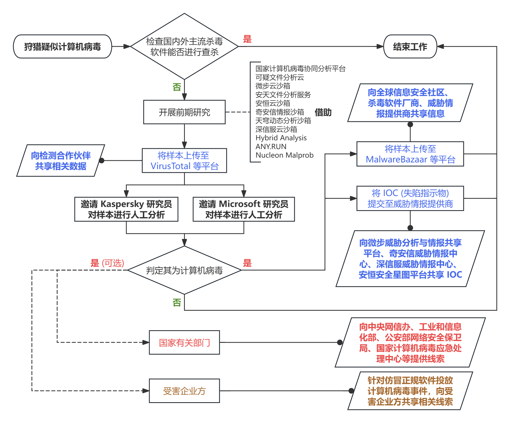

| &emsp;&emsp;&emsp;&emsp;&emsp;&emsp;&emsp;坚 持 筑 牢 国 家 网 络 安 全 屏 障&emsp;&emsp;&emsp;&emsp;&emsp;&emsp;&emsp; |
| :----------------------------------------------------------: |

| &emsp;&emsp;&emsp;&emsp;&emsp;&emsp;&emsp;没 有 网 络 安 全 就 没 有 国 家 安 全&emsp;&emsp;&emsp;&emsp;&emsp;&emsp;&emsp; |
| :----------------------------------------------------------: |

| &emsp;&emsp;&emsp;&emsp;&emsp;&emsp;&emsp;网 络 安 全 为 人 民&emsp;网 络 安 全 靠 人 民&emsp;&emsp;&emsp;&emsp;&emsp;&emsp;&emsp; |
| :----------------------------------------------------------: |

| &emsp;深 化 网 络 空 间 安 全 综 合 治 理&emsp;加 快 国 家 网 络 安 全 防 御 体 系 建 设&emsp; |
| :----------------------------------------------------------: |

<h1 align="center">灵糕中心 · 安全响应中心</h1>

<h3 align="center">Linggao Hub · Security Response Center (LGSRC)</h3>

[www.lgsrc.cn](https://www.lgsrc.cn) (门户) & [github.com/Lingggao/LGSRC](https://github.com/Lingggao/LGSRC) (GitHub)

&emsp;&emsp;**用于打击计算机病毒与恶意网站的 “[灵糕中心](https://github.com/Lingggao/LGHUB) · 安全响应中心”**。由独立网络安全研究员、中国计算机学会 (CCF) 会员兼计算机安全专业委员会委员 [**Ling Gao**](https://github.com/Lingggao/LGSRC/blob/main/Documents/Leadership.md) 领导。灵糕中心 · 安全响应中心创立于 2025 年 12 月 20 日。

> [!IMPORTANT]
>
> &emsp;灵糕中心为独立非营利组织，与其他企业不构成隶属、雇佣、代理等关系。

&emsp;&emsp;**宗旨**：独立管理、放眼全国、数据精确、打击迅速

## 工作流程

【**计算机病毒 / 恶意软件**】

---

【**恶意网站**】

---

**满足以下任一条件时，数据无需填入表格**

1. 多数杀毒软件可拦截该文件或网站，无需进行人工分析
2. 经前期分析，可 100% 确认为正常文件或网站
3. Microsoft 与 Kaspersky 安全研究员判定该文件或网站安全
4. 该文件或网站首次发现日期距今已超过 30 天
5. 由其他从业人员或志愿者发现、分析并上报，本中心全程未参与

## 数据

&emsp;&emsp;上次更新时间：2026 年 11 月 27 日 3:00 (GMT+8)

&emsp;&emsp;**截至 2026 年 11 月 27 日，本中心已打击计算机病毒 / 恶意软件 2,084 个、恶意网站 1,176 个，累计为潜在受害者规避经济损失约 8,857,000 元人民币**。[ $$E = \sum (W_i \times P_{\text{exec}} \times N_{\text{victim}} \times P_{\text{monetize}} \times V_{\text{loss}})$$ ] ([何意味？](https://github.com/Lingggao/LGSRC/blob/main/Documents/LossModel.md))

&emsp;&emsp;在对抗网络犯罪的崇高事业中，本中心仅承担了少量协调类工作。**恶意载荷从发现到清除，离不开国家有关部门、安全社区与研究员、杀毒软件厂商及威胁情报提供商的共同努力**。在此，谨向他们致以诚挚谢意。

---

&emsp;&emsp;**本中心每打击 1 个计算机病毒或恶意网站，将同步向[联合国儿童基金会](https://www.unicef.org/zh) “爱心为救灾” 计划捐赠 1 元人民币** (每月上限 230 元)。该计划旨在支持中国及其他国家实现可持续发展目标，尤其致力于为困境儿童提供援助。([捐款收据](https://github.com/Lingggao/LGSRC/blob/main/Images/%E6%8D%90%E6%AC%BE%E6%94%B6%E6%8D%AE.png))

&emsp;&emsp;2026 年 7 月 10 日，本中心通过广西慈善联合总会，向广西南宁贵港洪涝灾害受灾群众[捐赠](https://github.com/Lingggao/LGSRC/blob/main/Images/%E5%B9%BF%E8%A5%BF%E6%B4%AA%E6%B6%9D%E7%81%BE%E5%AE%B3.jpeg)人民币 2,026 元；2026 年 8 月 28 日，本中心通过上海市红十字会，向西藏吉隆泥石流灾害抢险救援工作[捐赠](https://github.com/Lingggao/LGSRC/blob/main/Images/%E8%A5%BF%E8%97%8F%E6%B3%A5%E7%9F%B3%E6%B5%81%E7%81%BE%E5%AE%B3.jpg)人民币 1,500 元。

---

【**计算机病毒 / 恶意软件**】

> [!CAUTION]
>
> &emsp;为确保安全，本中心**不提供**计算机病毒 / 恶意软件样本下载服务。

|    日期    |          文件名           |           检测           |                            SHA256                            |             Internal ID              |                          VirusTotal                          |                        MalwareBazaar                         | 编号 |
| :--------: | :-----------------------: | :----------------------: | :----------------------------------------------------------: | :----------------------------------: | :----------------------------------------------------------: | :----------------------------------------------------------: | :--: |
| 2026/11/21 |   wangshangliao···.exe    |   **银狐 (SilverFox)**   | 04809ce8e8257c44555606fbf0791f4a00ed32fc38e0b8978b47bb9e548ca50b | 4352ab36-504a-4e9d-b5dd-7004c4b36ab6 | [VirusTotal](https://www.virustotal.com/gui/file/04809ce8e8257c44555606fbf0791f4a00ed32fc38e0b8978b47bb9e548ca50b) (13) | [MalwareBazaar Database](https://bazaar.abuse.ch/sample/04809ce8e8257c44555606fbf0791f4a00ed32fc38e0b8978b47bb9e548ca50b) | 2057 |
| 2026/11/21 |    专用收发接码器.exe     |   **银狐 (SilverFox)**   | 4c435f53bf613e32ec0919dfe6b510d9ad804c8ad7c7585c95f5f0851ae95807 |                  无                  | [VirusTotal](https://www.virustotal.com/gui/file/4c435f53bf613e32ec0919dfe6b510d9ad804c8ad7c7585c95f5f0851ae95807) (40) | [MalwareBazaar Database](https://bazaar.abuse.ch/sample/4c435f53bf613e32ec0919dfe6b510d9ad804c8ad7c7585c95f5f0851ae95807) | 2058 |
| 2026/11/21 |    154_211_92_145.exe     |   **银狐 (SilverFox)**   | 50c2414463c0677e5b5d6d7c37ab1fa76c3f3ccfcb815cf2cf72d0661eda8ea5 | 35444bd0-6412-44bb-a3b6-d15fb9958114 | [VirusTotal](https://www.virustotal.com/gui/file/50c2414463c0677e5b5d6d7c37ab1fa76c3f3ccfcb815cf2cf72d0661eda8ea5) (34) | [MalwareBazaar Database](https://bazaar.abuse.ch/sample/50c2414463c0677e5b5d6d7c37ab1fa76c3f3ccfcb815cf2cf72d0661eda8ea5) | 2059 |
| 2026/11/21 |   deepsk_x64.in.11.exe    | **银狐 (SilverFox.PHL)** | 2264e6958399df51e2f9c244f8c9dfc85fba3f55ec942a45afdc94035dad284a | 310155a1-84eb-4961-ad4a-4f3cccc66f14 | [VirusTotal](https://www.virustotal.com/gui/file/2264e6958399df51e2f9c244f8c9dfc85fba3f55ec942a45afdc94035dad284a) (36) | [MalwareBazaar Database](https://bazaar.abuse.ch/sample/2264e6958399df51e2f9c244f8c9dfc85fba3f55ec942a45afdc94035dad284a) | 2060 |
| 2026/11/23 |   11.22Tduinfwarw03.exe   |   **银狐 (SilverFox)**   | 8ed54a14b0be914534c4fbcfc595bd93328bd0aac036df213023a648f97947a3 | c241cffe-f636-4435-bf5c-2f5cef16834b | [VirusTotal](https://www.virustotal.com/gui/file/8ed54a14b0be914534c4fbcfc595bd93328bd0aac036df213023a648f97947a3) (10) | [MalwareBazaar Database](https://bazaar.abuse.ch/sample/8ed54a14b0be914534c4fbcfc595bd93328bd0aac036df213023a648f97947a3) | 2061 |
| 2026/11/23 |        ToDesk.exe         |   **银狐 (SilverFox)**   | 6fefa6f1c4e92d48464ff4b3ae9bc1dc0492067515080bdd0498826fb44362c9 | 8b348407-a4a4-4136-8e02-17d9081aa077 | [VirusTotal](https://www.virustotal.com/gui/file/6fefa6f1c4e92d48464ff4b3ae9bc1dc0492067515080bdd0498826fb44362c9) (25) | [MalwareBazaar Database](https://bazaar.abuse.ch/sample/6fefa6f1c4e92d48464ff4b3ae9bc1dc0492067515080bdd0498826fb44362c9) | 2062 |
| 2026/11/23 |     ToDesk_4.8.88.exe     |   **银狐 (SilverFox)**   | 7214974da75a04d4ba0450d7485e412d09742af832f60084eaf07deaed678b0f | 10fb6394-0dfd-4f02-8234-00d112b2bf54 | [VirusTotal](https://www.virustotal.com/gui/file/7214974da75a04d4ba0450d7485e412d09742af832f60084eaf07deaed678b0f) (7) | [MalwareBazaar Database](https://bazaar.abuse.ch/sample/7214974da75a04d4ba0450d7485e412d09742af832f60084eaf07deaed678b0f) | 2063 |
| 2026/11/23 |   Todesk_Big_3.1.1.exe    |   **银狐 (SilverFox)**   | 9522b80562dcacd2c4e5f38a345e643276701dab068a180eae8dbdc22e165068 | 90800e63-958a-41e8-a5cc-bc1ec792f262 | [VirusTotal](https://www.virustotal.com/gui/file/9522b80562dcacd2c4e5f38a345e643276701dab068a180eae8dbdc22e165068) (4) | [MalwareBazaar Database](https://bazaar.abuse.ch/sample/9522b80562dcacd2c4e5f38a345e643276701dab068a180eae8dbdc22e165068) | 2064 |
| 2026/11/23 |      ToDesk_x64.exe       |   **银狐 (SilverFox)**   | ce53d6acb0a7c225070e67f365a6f59c8b711aa7784fb205cdb2229d1cb4d521 | 219631b3-d75e-428c-9a36-07312d29af3e | [VirusTotal](https://www.virustotal.com/gui/file/ce53d6acb0a7c225070e67f365a6f59c8b711aa7784fb205cdb2229d1cb4d521) (3) | [MalwareBazaar Database](https://bazaar.abuse.ch/sample/ce53d6acb0a7c225070e67f365a6f59c8b711aa7784fb205cdb2229d1cb4d521) | 2065 |
| 2026/11/25 |  11.23lvcha vpnawfr.exe   |   **银狐 (SilverFox)**   | 9ab5bb118bc94276e37d1ba709f3acf453e9accb3dfae8d527a1fff2c3f9d094 | 55f29f4e-11c5-4ace-b17b-6387180b4dcd | [VirusTotal](https://www.virustotal.com/gui/file/9ab5bb118bc94276e37d1ba709f3acf453e9accb3dfae8d527a1fff2c3f9d094) (17) | [MalwareBazaar Database](https://bazaar.abuse.ch/sample/9ab5bb118bc94276e37d1ba709f3acf453e9accb3dfae8d527a1fff2c3f9d094) | 2066 |
| 2026/11/25 |   deepsk_x64.in.01.exe    | **银狐 (SilverFox.PHL)** | 7fa72725265015721336e7fd302efbe4d56e2ae7df77dbd538fcb6beaebae5e0 | 34eee78f-21bb-4830-9427-7f00b810d596 | [VirusTotal](https://www.virustotal.com/gui/file/7fa72725265015721336e7fd302efbe4d56e2ae7df77dbd538fcb6beaebae5e0) (31) | [MalwareBazaar Database](https://bazaar.abuse.ch/sample/7fa72725265015721336e7fd302efbe4d56e2ae7df77dbd538fcb6beaebae5e0) | 2067 |
| 2026/11/25 |   deepsk_x64.in.15.exe    | **银狐 (SilverFox.PHL)** | 7f273c55a3403bf35f0429c69f5c96d87d26e6002b9558859247d755f053c664 | 7cb6d254-57a4-4318-ac22-59712c63a1fe | [VirusTotal](https://www.virustotal.com/gui/file/7f273c55a3403bf35f0429c69f5c96d87d26e6002b9558859247d755f053c664) (39) | [MalwareBazaar Database](https://bazaar.abuse.ch/sample/7f273c55a3403bf35f0429c69f5c96d87d26e6002b9558859247d755f053c664) | 2068 |
| 2026/11/25 |      卡密激活器.exe       |   **银狐 (SilverFox)**   | 83b2cc9d7d9f05e278a4cdc5629dcf6fdda4eb1c6f36e62ddc725c6bd1b7019a | 12d863bc-7d51-4a04-abcd-cc966b132160 | [VirusTotal](https://www.virustotal.com/gui/file/83b2cc9d7d9f05e278a4cdc5629dcf6fdda4eb1c6f36e62ddc725c6bd1b7019a) (8) | [MalwareBazaar Database](https://bazaar.abuse.ch/sample/83b2cc9d7d9f05e278a4cdc5629dcf6fdda4eb1c6f36e62ddc725c6bd1b7019a) | 2069 |
| 2026/11/25 |   跨境王···群发软件.exe   |   **银狐 (SilverFox)**   | fe4054075a568a55beea3dfd1cf864beee4c27eabc2a30d6b022114317f08d31 | 02856e33-06db-44d1-9e38-2546f90b23d7 | [VirusTotal](https://www.virustotal.com/gui/file/fe4054075a568a55beea3dfd1cf864beee4c27eabc2a30d6b022114317f08d31) (11) | [MalwareBazaar Database](https://bazaar.abuse.ch/sample/fe4054075a568a55beea3dfd1cf864beee4c27eabc2a30d6b022114317f08d31) | 2070 |
| 2026/11/25 |  物资采购清单···jpg.exe   |   **银狐 (SilverFox)**   | 2074b31068d496d9fcf67c6ba314ce764b4d40e5b9144d0b8fb94c2d8ffbb5db | 4e6131ec-5041-48f1-a3dd-f9566113b4ec | [VirusTotal](https://www.virustotal.com/gui/file/2074b31068d496d9fcf67c6ba314ce764b4d40e5b9144d0b8fb94c2d8ffbb5db) (9) | [MalwareBazaar Database](https://bazaar.abuse.ch/sample/2074b31068d496d9fcf67c6ba314ce764b4d40e5b9144d0b8fb94c2d8ffbb5db) | 2071 |
| 2026/11/26 |          145.exe          |   **银狐 (SilverFox)**   | 06f272750f81540d8cb1808be0b79c4e963bb67ff035cb96ee4d1568fe70ace6 | de8a2bd5-8680-4c96-956f-7a061f40a3b6 | [VirusTotal](https://www.virustotal.com/gui/file/06f272750f81540d8cb1808be0b79c4e963bb67ff035cb96ee4d1568fe70ace6) (12) | [MalwareBazaar Database](https://bazaar.abuse.ch/sample/06f272750f81540d8cb1808be0b79c4e963bb67ff035cb96ee4d1568fe70ace6) | 2072 |
| 2026/11/26 |       DeepSeek.msi        |   **银狐 (SilverFox)**   | 2662855765746153854429911ea4f23f827ffd5eb57f25a504acafadcd911430 | 390bc58e-44af-4160-a2c0-484bdadc4713 | [VirusTotal](https://www.virustotal.com/gui/file/2662855765746153854429911ea4f23f827ffd5eb57f25a504acafadcd911430) (7) |                              无                              | 2073 |
| 2026/11/26 |   dpinst_x64.in.02.exe    | **银狐 (SilverFox.PHL)** | 7317f68c0a92198d6c7858d3ee96ab9bbebb9acaba11c5871bd93dc1fced7e70 | 670634f8-8c83-4d78-bb78-2df8764c34e4 | [VirusTotal](https://www.virustotal.com/gui/file/7317f68c0a92198d6c7858d3ee96ab9bbebb9acaba11c5871bd93dc1fced7e70) (27) | [MalwareBazaar Database](https://bazaar.abuse.ch/sample/7317f68c0a92198d6c7858d3ee96ab9bbebb9acaba11c5871bd93dc1fced7e70) | 2074 |
| 2026/11/26 |   dpinst_x64.in.06.exe    | **银狐 (SilverFox.PHL)** | 67d76863b812ef960b44e32a67fd2f3a6eebc857c073a448d8dccf3f18002622 | 01ac60d7-d399-4a56-ac59-96699f13189f | [VirusTotal](https://www.virustotal.com/gui/file/67d76863b812ef960b44e32a67fd2f3a6eebc857c073a448d8dccf3f18002622) (27) | [MalwareBazaar Database](https://bazaar.abuse.ch/sample/67d76863b812ef960b44e32a67fd2f3a6eebc857c073a448d8dccf3f18002622) | 2075 |
| 2026/11/26 |   dpinst_x64.in.07.exe    | **银狐 (SilverFox.PHL)** | d8d80c729b59fce3c828d489cd4051d1fe244bd33ecdd5bee9e200a7dee61d96 | a91116e0-0ba6-4921-9bc5-b9dbe4e58453 | [VirusTotal](https://www.virustotal.com/gui/file/d8d80c729b59fce3c828d489cd4051d1fe244bd33ecdd5bee9e200a7dee61d96) (27) | [MalwareBazaar Database](https://bazaar.abuse.ch/sample/d8d80c729b59fce3c828d489cd4051d1fe244bd33ecdd5bee9e200a7dee61d96) | 2076 |
| 2026/11/27 |   aisizhushou-4.5.0.msi   |   **银狐 (SilverFox)**   | 9b3e3446030e319e7dcb9c9d50b90ed4df5256443224cf0e6f62386bc6e73d2e |                                      | [VirusTotal](https://www.virustotal.com/gui/file/9b3e3446030e319e7dcb9c9d50b90ed4df5256443224cf0e6f62386bc6e73d2e) (18) |                              无                              | 2077 |
| 2026/11/27 |   Aisizhushou-i4···.msi   |   **银狐 (SilverFox)**   | 8a170fe8b00f297b1e1fa80397598ef12d2d4e5e4de14a7a10fe3fbd8ee18d02 |                                      | [VirusTotal](https://www.virustotal.com/gui/file/8a170fe8b00f297b1e1fa80397598ef12d2d4e5e4de14a7a10fe3fbd8ee18d02) (22) |                              无                              | 2078 |
| 2026/11/27 |   dpinst_x64.in.04.exe    | **银狐 (SilverFox.PHL)** | b25df9945b1d862716af0349a51650acfaa09fffb22d6e6c25c4aa0ff4d6f41d |                                      | [VirusTotal](https://www.virustotal.com/gui/file/b25df9945b1d862716af0349a51650acfaa09fffb22d6e6c25c4aa0ff4d6f41d) (32) | [MalwareBazaar Database](https://bazaar.abuse.ch/sample/b25df9945b1d862716af0349a51650acfaa09fffb22d6e6c25c4aa0ff4d6f41d) | 2079 |
| 2026/11/27 | i4Toolls_v9.12.012···.exe |   **银狐 (SilverFox)**   | 6e418bb20b438f2e34f2ece61923df90687a437fb6048eaf5b813df87ad2458e |                                      | [VirusTotal](https://www.virustotal.com/gui/file/6e418bb20b438f2e34f2ece61923df90687a437fb6048eaf5b813df87ad2458e) (11) |                              无                              | 2080 |
| 2026/11/27 |        i4Tools.exe        | **银狐 (SilverFox.wos)** | 88115943add5dfb18dceae7102086025474bd4fd4a9530c36c1912d098fd63c4 |                                      | [VirusTotal](https://www.virustotal.com/gui/file/88115943add5dfb18dceae7102086025474bd4fd4a9530c36c1912d098fd63c4) (9) |                              无                              | 2081 |
| 2026/11/27 |   i4Tools···222527.exe    |   **银狐 (SilverFox)**   | 4ef7436bf860962e3f2d2b5549280aa4ab84416b77350148571e541699519fb2 |                                      | [VirusTotal](https://www.virustotal.com/gui/file/4ef7436bf860962e3f2d2b5549280aa4ab84416b77350148571e541699519fb2) (27) |                              无                              | 2082 |
| 2026/11/27 |   typeeasy.22063···.exe   | **银狐 (SilverFox.CML)** | 638f19ceac8f03c7593e286d3ba7e29af0d2e11ad35ce70a4a7ec78f40b71dfa |                                      | [VirusTotal](https://www.virustotal.com/gui/file/638f19ceac8f03c7593e286d3ba7e29af0d2e11ad35ce70a4a7ec78f40b71dfa) (17) | [MalwareBazaar Database](https://bazaar.abuse.ch/sample/638f19ceac8f03c7593e286d3ba7e29af0d2e11ad35ce70a4a7ec78f40b71dfa) | 2083 |
| 2026/11/27 |  win-Bundle x643014.exe   |   **银狐 (SilverFox)**   | d8a1bf524932919e110d83ce8236009f9cc31157069d9da48ab573c195caf43a |                                      | [VirusTotal](https://www.virustotal.com/gui/file/d8a1bf524932919e110d83ce8236009f9cc31157069d9da48ab573c195caf43a) (5) | [MalwareBazaar Database](https://bazaar.abuse.ch/sample/d8a1bf524932919e110d83ce8236009f9cc31157069d9da48ab573c195caf43a) | 2084 |
|   ——————   |       ————————————        |       ————————————       |             ———————————————————————————————————              |         ————————————————————         |                           ————————                           |                         ————————————                         | ———  |

> [!NOTE]
>
> &emsp;只显示最近 20 条数据，更早数据详见 LGSRC/[Archive_1.md](https://github.com/Lingggao/LGSRC/blob/main/Archive_1.md) (计算机病毒 / 恶意软件归档)。

---

【**恶意网站**】

> [!CAUTION]
>
> &emsp;为确保安全，网站地址将用 “hxxps://” 与 “[.]” 进行替换。**切勿尝试访问表格中列出的任何网址**。

|    日期    |                   URL                   |             类别             |                           有效载荷                           |                         URLhaus                          | 编号 |
| :--------: | :-------------------------------------: | :--------------------------: | :----------------------------------------------------------: | :------------------------------------------------------: | :--: |
| 2026/11/23 |     hxxps://todesk-check[.]com[.]cn     |  **仿冒 ToDesk、传播病毒**   |                           同 1133                            |                            无                            | 1135 |
| 2026/11/23 |     hxxps://it[.]todeck[.]com[.]cn      |  **仿冒 ToDesk、传播病毒**   |    (随机跳转) hxxps://2556web[.]cdn-todesk[.]com[.]cn 等     |                            无                            | 1136 |
| 2026/11/23 | hxxps://2556web[.]cdn-todesk[.]com[.]cn |  **仿冒 ToDesk、传播病毒**   | hxxps://pub-e4396ac9c01344db998f3a97ab6a8226[.]r2[.]dev/11[.]22Tduinfwarw0eq[.]zip | [URLhaus Database](https://urlhaus.abuse.ch/url/4074231) | 1137 |
| 2026/11/23 |     hxxps://app[.]toderk[.]com[.]cn     |  **仿冒 ToDesk、传播病毒**   |  同 1137，仅在必应搜索结果中点击该链接时才会跳转至恶意网站   |                            无                            | 1138 |
| 2026/11/23 |       hxxps://todeska[.]com[.]cn        |  **仿冒 ToDesk、传播病毒**   |     hxxps://sooyun-yun[.]com[.]cn/donwnload/ToDesk[.]zip     | [URLhaus Database](https://urlhaus.abuse.ch/url/4074233) | 1139 |
| 2026/11/23 |       hxxps://todeskau[.]com[.]cn       |  **仿冒 ToDesk、传播病毒**   |                           同 1139                            |                            无                            | 1140 |
| 2026/11/23 |        hxxps://todenk[.]com[.]cn        |  **仿冒 ToDesk、传播病毒**   | hxxps://todenk[.]com[.]cn/generated_pages/moban53/static/pic/ToDesk[.]zip | [URLhaus Database](https://urlhaus.abuse.ch/url/4074234) | 1141 |
| 2026/11/25 |     hxxps://deepseekaps[.]com[.]cn      | **仿冒 DeepSeek、传播病毒**  | hxxps://uhgtfhjnbb[.]oss-cn-hongkong[.]aliyuncs[.]com/DeepSeek[.]zip |                            无                            | 1142 |
| 2026/11/25 |      hxxps://deepseekj[.]com[.]cn       | **仿冒 DeepSeek、传播病毒**  |                           同 1142                            |                            无                            | 1143 |
| 2026/11/25 |  hxxps://www[.]deepseek-hh[.]com[.]cn   | **仿冒 DeepSeek、传播病毒**  |                           同 1142                            |                            无                            | 1144 |
| 2026/11/25 |  hxxps://www[.]deepseek-ap[.]com[.]cn   | **仿冒 DeepSeek、传播病毒**  |                           同 1142                            |                            无                            | 1145 |
| 2026/11/25 |    hxxps://www[.]trmi25t[.]com/dsluc    |       **传播银狐病毒**       |                       有，载荷提取失败                       | [URLhaus Database](https://urlhaus.abuse.ch/url/4075896) | 1146 |
| 2026/11/25 |   (回头看) hxxps://deepseek-nf[.]com    | **仿冒 DeepSeek、传播病毒**  |                           同 1146                            |                            无                            | 1147 |
| 2026/11/26 | (回头看) hxxps://deepseekaps[.]com[.]cn | **仿冒 DeepSeek、传播病毒**  | hxxps://9380washington-blvd[.]oss-cn-hongkong[.]aliyuncs[.]com/DeepSeek[.]zip |                            无                            | 1148 |
| 2026/11/26 |    hxxps://www[.]ru4w1dq[.]com/dsluc    |       **传播银狐病毒**       |                       有，载荷提取失败                       | [URLhaus Database](https://urlhaus.abuse.ch/url/4076581) | 1149 |
| 2026/11/26 |        hxxps://deepseekmc[.]net         | **仿冒 DeepSeek、传播病毒**  |                           同 1149                            |                            无                            | 1150 |
| 2026/11/26 |       hxxp://deepsenk[.]com[.]cn        | **仿冒 DeepSeek、传播病毒**  |      (随机跳转) hxxps://909web[.]cdns-deepseek[.]com 等      |                            无                            | 1151 |
| 2026/11/26 |  hxxps://909web[.]cdns-deepseek[.]com   | **仿冒 DeepSeek、传播病毒**  | hxxps://qqqwww2222222[.]tos-cn-shanghai[.]volces[.]com/124322281030_setup[.]zip | [URLhaus Database](https://urlhaus.abuse.ch/url/4076582) | 1152 |
| 2026/11/26 |  hxxps://2581web[.]cdns-deepseek[.]com  | **仿冒 DeepSeek、传播病毒**  |  同 1151，仅在必应搜索结果中点击该链接时才会跳转至恶意网站   |                            无                            | 1153 |
| 2026/11/26 |   hxxps://net[.]deepseekds[.]com[.]cn   | **仿冒 DeepSeek、传播病毒**  |  同 1151，仅在必应搜索结果中点击该链接时才会跳转至恶意网站   |                            无                            | 1154 |
| 2026/11/27 |       https://daziijinshan-gq.com       | **仿冒金山打字通、传播病毒** |              hxxps://www[.]ru4w1dq[.]com/dsluc               |                            无                            | 1155 |
| 2026/11/27 |     https://jinshandaazitong.com.cn     | **仿冒金山打字通、传播病毒** | https://pub-a224f807124742f6bd3e49da8fe762a5.r2.dev/typeeasy.22063.12012.0.zip |                            无                            | 1156 |
| 2026/11/27 |         https://jinsdzt.com.cn          | **仿冒金山打字通、传播病毒** |                           同 1156                            |                            无                            | 1157 |
| 2026/11/27 |     https://jinshandazitong.com.cn      | **仿冒金山打字通、传播病毒** |                           同 1156                            |                            无                            | 1158 |
| 2026/11/27 |       https://pc-ijinshan.com.cn        | **仿冒金山打字通、传播病毒** |    https://amcchina.com/download/win-Bundle%20x643014.zip    |                            无                            | 1159 |
| 2026/11/27 |          https://pc-is.com.cn           |  **仿冒爱思助手、传播病毒**  | https://bucketobs.oss-cn-hongkong.aliyuncs.com/i4Toolls_v9.12.012_Setuip_x64.zip |                            无                            | 1160 |
| 2026/11/27 |         https://apps-is.com.cn          |  **仿冒爱思助手、传播病毒**  |                           同 1160                            |                            无                            | 1161 |
| 2026/11/27 |        https://i4tool-qd.com.cn         |  **仿冒爱思助手、传播病毒**  | https://pub-8c944cde37db4a589e86137d049091b0.r2.dev/Aliyrne-s3/Lmynrewb/Aisizhushou-i4-win6.80.8.zip |                            无                            | 1162 |
| 2026/11/27 |         https://i4varko.com.cn          |  **仿冒爱思助手、传播病毒**  | https://software-download-hk.oss-cn-hongkong.aliyuncs.com/aisizhushou-4.5.0.zip |                            无                            | 1163 |
| 2026/11/27 |         https://i4tavix.com.cn          |  **仿冒爱思助手、传播病毒**  |                           同 1163                            |                            无                            | 1164 |
| 2026/11/27 |        https://i4tool-xsx.com.cn        |  **仿冒爱思助手、传播病毒**  |                           同 1163                            |                            无                            | 1165 |
| 2026/11/27 |        https://i4tool-pnc.com.cn        |  **仿冒爱思助手、传播病毒**  |                           同 1163                            |                            无                            | 1166 |
| 2026/11/27 |        https://i4toolkent.com.cn        |  **仿冒爱思助手、传播病毒**  |                           同 1163                            |                            无                            | 1167 |
| 2026/11/27 |          https://i4zvok.com.cn          |  **仿冒爱思助手、传播病毒**  |                           同 1163                            |                            无                            | 1168 |
| 2026/11/27 |          https://i4zuno.com.cn          |  **仿冒爱思助手、传播病毒**  |                           同 1163                            |                            无                            | 1169 |
| 2026/11/27 |          https://i4mexo.com.cn          |  **仿冒爱思助手、传播病毒**  |                           同 1163                            |                            无                            | 1170 |
| 2026/11/27 |          https://i4nexu.com.cn          |  **仿冒爱思助手、传播病毒**  |                           同 1163                            |                            无                            | 1171 |
| 2026/11/27 |          https://i4xiro.com.cn          |  **仿冒爱思助手、传播病毒**  |                           同 1163                            |                            无                            | 1172 |
| 2026/11/27 |        https://i4toolawin.com.cn        |  **仿冒爱思助手、传播病毒**  |                           同 1163                            |                            无                            | 1173 |
| 2026/11/27 |          https://i4qeno.com.cn          |  **仿冒爱思助手、传播病毒**  |                           同 1163                            |                            无                            | 1174 |
| 2026/11/27 |            https://i4-mi.cn             |  **仿冒爱思助手、传播病毒**  | https://i4-mi.cn/generated_pages/moban40/static/download/i4Tools.zip |                            无                            | 1175 |
| 2026/11/27 |         https://www.i4-pc1.com          |  **仿冒爱思助手、传播病毒**  | https://001-ascjkasckj-acshkask-xnzjsknka.oss-ap-southeast-1.aliyuncs.com/i4Tools_Setup_x6420260921_222527.zip |                            无                            | 1176 |
|   ——————   |          ————————————————————           |       ———————————————        |                ——————————————————————————————                |                        ——————————                        | ———  |

> [!NOTE]
>
> &emsp;只显示最近 20 条数据，更早数据详见 LGSRC/[Archive_2.md](https://github.com/Lingggao/LGSRC/blob/main/Archive_2.md) (恶意网站归档)。
>
> &emsp;暂时无暇核实与处理的疑似恶意网站详见 LGSRC/[Archive_3.md](https://github.com/Lingggao/LGSRC/blob/main/Archive_3.md) (仅记录，未核实且未打击)。

## 交流与合作

&emsp;&emsp;[**LGSRC 管理委员会**](https://github.com/Lingggao/LGSRC/blob/main/Documents/Leadership.md)

&emsp;&emsp;如需联系 Ling Gao，请发送电子邮件至 ling@lghub.org 或 ling_gao@acm.org。谢谢！🥰

&emsp;&emsp;如需本中心协助检测**文件**是否存在恶意行为，请将其上传至[微步云沙箱](https://s.threatbook.com)及 [VirusTotal](https://www.virustotal.com)，并将 **SHA256** 填入[本表单](https://forms.cloud.microsoft/Pages/ResponsePage.aspx?id=39DabECOEk2JZekK_Z5UjJJAHDqug_FNgSvl5TTF-MJUM1pISDk0VTFLNjhHVVpJQ0FHVDlLMjcwMi4u) (请勿直接发送文件本体)；如需本中心协助检测**网站**是否存在恶意行为，请将 **URL** 填入[本表单](https://forms.cloud.microsoft/Pages/ResponsePage.aspx?id=39DabECOEk2JZekK_Z5UjJJAHDqug_FNgSvl5TTF-MJUM1pISDk0VTFLNjhHVVpJQ0FHVDlLMjcwMi4u)。同时，请提供您的**电子邮件地址**。本中心将独立进行分析，并于 2 个工作日内将检测结果发送至您填写的邮箱。上传至第三方平台前，请仔细阅读相关服务条款与隐私政策，并确保文件与网站中不含任何个人信息。

---

&emsp;&emsp;[**恶意软件研究工具集**](https://github.com/Lingggao/LGSRC/blob/main/Documents/Toolkit.md)

&emsp;&emsp;[《**工作成效报告**》](https://github.com/Lingggao/LGSRC/blob/main/Documents/Impact.md) (二〇二六年十月)

&emsp;&emsp;[《**常被 “银狐” 犯罪团伙仿冒的软件列表及注意事项**》](https://github.com/Lingggao/LGSRC/blob/main/Documents/List.md) (已收录 111 款软件)

&emsp;&emsp;[《**“银狐” 威胁动态：官方及网络安全企业文章汇编**》](https://github.com/Lingggao/LGSRC/blob/main/Documents/SilverFox_Articles.md) (已收录 51 篇文章)

&emsp;&emsp;**银狐 IOC 情报合集**：[**VirusTotal**](https://www.virustotal.com/gui/collection/c4dd0a03e18770678ba094169aa006095d3a0cbda29587567507f8d956db38e1) + [**LevelBlue OTX**](https://otx.alienvault.com/pulse/6a36fe5a3c1568785b59c4d7) (已收录 2,521 项情报，实时更新)

## 人工智能 (AI)

- AI Agent 技能：[**vt-insight**](https://github.com/Lingggao/LGSRC/blob/main/vt-insight/SKILL.md)
- DeepSeek Harness 插件：[**threatbook-intel**](https://github.com/Lingggao/LGSRC/tree/main/dsh-plugins/threatbook-intel)

&emsp;&emsp;欢迎体验我们编写的 **AI Agent** 技能 [**vt-insight**](https://github.com/Lingggao/LGSRC/blob/main/vt-insight/SKILL.md)！该技能可用于在 VirusTotal 网站查询样本信息，自动整理并格式化输出查询报告。([效果图 ①](https://github.com/Lingggao/LGSRC/blob/main/Images/Rendering%201.png)) ([效果图 ②](https://github.com/Lingggao/LGSRC/blob/main/Images/Rendering%202.png)) 向 AI 大模型发送指令 `“将此 .md 文档作为 Skill 安装：https://github.com/Lingggao/LGSRC/blob/main/vt-insight/SKILL.md，安装成功后作简要介绍。”` 即可安装此技能，前往[**微步 Skill 广场**](https://x.threatbook.com/v5/skill/58eeb86ccd5fc240e8e04a24520e6158)或 [ClawHub](https://clawhub.ai/lingggao/vt-insight) 安装亦可。([vt-insight 技能安全审计报告](https://github.com/Lingggao/LGSRC/blob/main/Documents/vt-insight-security-audit-report%20(%E8%85%BE%E8%AE%AF%E5%AE%89%E5%85%A8%E4%BA%91%E9%BC%8E%E5%AE%9E%E9%AA%8C%E5%AE%A4).md)) ([微步 SafeSkill 检测报告](https://safeskill.cn/report/3bd851387126652d775c0a5e42fa60051b1ca16e6cad7c9b3088e89b09105a2b))

&emsp;&emsp;欢迎体验我们制作的 **DeepSeek Harness** 插件 [**threatbook-intel**](https://github.com/Lingggao/LGSRC/tree/main/dsh-plugins/threatbook-intel)！该插件可用于在 DSH 界面绑定微步 X 情报中心 API Key，输入文件 Hash、URL、域名、IP 等进行情报查询，支持 AI 总结与报告本地保存。([效果图 ①](https://github.com/Lingggao/LGSRC/blob/main/Images/Rendering%203.png)) ([效果图 ②](https://github.com/Lingggao/LGSRC/blob/main/Images/Rendering%204.png)) ([效果图 ③](https://github.com/Lingggao/LGSRC/blob/main/Images/Rendering%205.png)) 前往[**发布页**](https://github.com/Lingggao/LGSRC/releases)下载最新版本 `threatbook-intel-(版本号).zip` 安装包，解压后在 DSH 中点击 `“插件” > “添加插件”`，填入解压路径即可安装此插件。([threatbook-intel 插件安全自检报告](https://github.com/Lingggao/LGSRC/blob/main/dsh-plugins/docs/threatbook-intel-security-audit.md))

---

[回到顶部](#HEAD)

  

在 “[署名 - 相同方式共享 4.0](https://creativecommons.org/licenses/by-sa/4.0/legalcode.zh-Hans)” (CC BY-SA 4.0) 协议之条款下提供。

2025 - 2026, [Ling Gao](https://github.com/Lingggao/LGSRC/blob/main/Documents/Leadership.md), 灵糕中心 · 安全响应中心, [github.com/Lingggao/LGSRC](https://github.com/Lingggao/LGSRC)