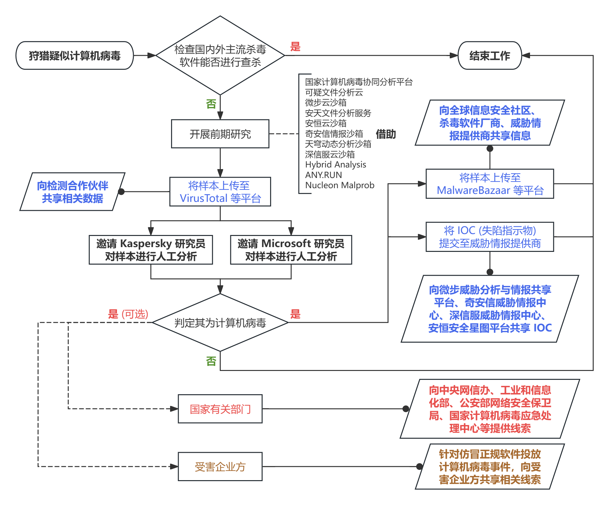
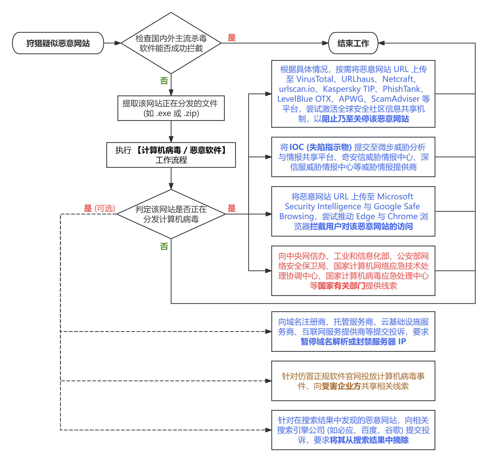

| &emsp;&emsp;&emsp;&emsp;&emsp;&emsp;&emsp;坚 持 筑 牢 国 家 网 络 安 全 屏 障&emsp;&emsp;&emsp;&emsp;&emsp;&emsp;&emsp; |
| :----------------------------------------------------------: |

| &emsp;&emsp;&emsp;&emsp;&emsp;&emsp;&emsp;没 有 网 络 安 全 就 没 有 国 家 安 全&emsp;&emsp;&emsp;&emsp;&emsp;&emsp;&emsp; |
| :----------------------------------------------------------: |

| &emsp;&emsp;&emsp;&emsp;&emsp;&emsp;&emsp;网 络 安 全 为 人 民&emsp;网 络 安 全 靠 人 民&emsp;&emsp;&emsp;&emsp;&emsp;&emsp;&emsp; |
| :----------------------------------------------------------: |

| &emsp;深 化 网 络 空 间 安 全 综 合 治 理&emsp;加 快 国 家 网 络 安 全 防 御 体 系 建 设&emsp; |
| :----------------------------------------------------------: |

<h1 align="center">灵糕中心 · 安全响应中心</h1>

<h3 align="center">Linggao Hub · Security Response Center (LGSRC)</h3>

[www.lgsrc.cn](https://www.lgsrc.cn) (门户) & [github.com/Lingggao/LGSRC](https://github.com/Lingggao/LGSRC) (GitHub)

&emsp;&emsp;**用于打击计算机病毒与恶意网站的 “[灵糕中心](https://github.com/Lingggao/LGHUB) · 安全响应中心”**。由独立网络安全研究员、中国计算机学会 (CCF) 会员兼计算机安全专业委员会委员 [**Ling Gao**](https://github.com/Lingggao/LGSRC/blob/main/Documents/Leadership.md) 领导。灵糕中心 · 安全响应中心创立于 2025 年 12 月 20 日。

> [!IMPORTANT]
>
> &emsp;灵糕中心为独立非营利组织，与其他企业不构成隶属、雇佣、代理等关系。

&emsp;&emsp;**宗旨**：独立管理、放眼全国、数据精确、打击迅速

## 工作流程

【**计算机病毒 / 恶意软件**】

---

【**恶意网站**】

---

**满足以下任一条件时，数据无需填入表格**

1. 多数杀毒软件可拦截该文件或网站，无需进行人工分析
2. 经前期分析，可 100% 确认为正常文件或网站
3. Microsoft 与 Kaspersky 安全研究员判定该文件或网站安全
4. 该文件或网站首次发现日期距今已超过 30 天
5. 由其他从业人员或志愿者发现、分析并上报，本中心全程未参与

## 数据

&emsp;&emsp;上次更新时间：2026 年 11 月 6 日 17:00 (GMT+8)

&emsp;&emsp;**截至 2026 年 11 月 6 日，本中心已打击计算机病毒 / 恶意软件 2,000 个、恶意网站 1,071 个，累计为潜在受害者规避经济损失约 8,500,000 元人民币**。[ $$E = \sum (W_i \times P_{\text{exec}} \times N_{\text{victim}} \times P_{\text{monetize}} \times V_{\text{loss}})$$ ] ([何意味？](https://github.com/Lingggao/LGSRC/blob/main/Documents/LossModel.md))

&emsp;&emsp;在对抗网络犯罪的崇高事业中，本中心仅承担了少量协调类工作。**恶意载荷从发现到清除，离不开国家有关部门、安全社区与研究员、杀毒软件厂商及威胁情报提供商的共同努力**。在此，谨向他们致以诚挚谢意。

---

&emsp;&emsp;**本中心每打击 1 个计算机病毒或恶意网站，将同步向[联合国儿童基金会](https://www.unicef.org/zh) “爱心为救灾” 计划捐赠 1 元人民币** (每月上限 230 元)。该计划旨在支持中国及其他国家实现可持续发展目标，尤其致力于为困境儿童提供援助。([捐款收据](https://github.com/Lingggao/LGSRC/blob/main/Images/%E6%8D%90%E6%AC%BE%E6%94%B6%E6%8D%AE.png))

&emsp;&emsp;2026 年 7 月 10 日，本中心通过广西慈善联合总会，向广西南宁贵港洪涝灾害受灾群众[捐赠](https://github.com/Lingggao/LGSRC/blob/main/Images/%E5%B9%BF%E8%A5%BF%E6%B4%AA%E6%B6%9D%E7%81%BE%E5%AE%B3.jpeg)人民币 2,026 元；2026 年 8 月 28 日，本中心通过上海市红十字会，向西藏吉隆泥石流灾害抢险救援工作[捐赠](https://github.com/Lingggao/LGSRC/blob/main/Images/%E8%A5%BF%E8%97%8F%E6%B3%A5%E7%9F%B3%E6%B5%81%E7%81%BE%E5%AE%B3.jpg)人民币 1,500 元。

---

【**计算机病毒 / 恶意软件**】

> [!CAUTION]
>
> &emsp;为确保安全，本中心**不提供**计算机病毒 / 恶意软件样本下载服务。

|   日期    |         文件名          |         检测         |                            SHA256                            |             Internal ID              |                          VirusTotal                          |                        MalwareBazaar                         | 编号 |
| :-------: | :---------------------: | :------------------: | :----------------------------------------------------------: | :----------------------------------: | :----------------------------------------------------------: | :----------------------------------------------------------: | :--: |
| 2026/11/2 |  BandiZip···signed.exe  | **银狐 (SilverFox)** | 41d9eb2f5418181cfe9a9955bdb1ec99692618759704b92f332d2d6e121fa4aa | 8e4d1b57-9099-4d1a-b497-9dfe1fbb03c7 | [VirusTotal](https://www.virustotal.com/gui/file/41d9eb2f5418181cfe9a9955bdb1ec99692618759704b92f332d2d6e121fa4aa) (8) | [MalwareBazaar Database](https://bazaar.abuse.ch/sample/41d9eb2f5418181cfe9a9955bdb1ec99692618759704b92f332d2d6e121fa4aa) | 1981 |
| 2026/11/3 |  207.56.28.153 (2).exe  | **银狐 (SilverFox)** | 5ea175c06fa2402c4aeac7816d051ab6c45307c4443221a25871b46267e028f0 | b5811cf6-1f0a-4257-81a5-63e522136902 | [VirusTotal](https://www.virustotal.com/gui/file/5ea175c06fa2402c4aeac7816d051ab6c45307c4443221a25871b46267e028f0) (23) | [MalwareBazaar Database](https://bazaar.abuse.ch/sample/5ea175c06fa2402c4aeac7816d051ab6c45307c4443221a25871b46267e028f0) | 1982 |
| 2026/11/3 |  207.56.28.198 (2).exe  | **银狐 (SilverFox)** | 217503ba2e91713bcce9f9a221f69f192655b53d0d0596eb6467d71580f2b01c | 4de47c59-6c50-4fdc-a4fc-26d946f84d71 | [VirusTotal](https://www.virustotal.com/gui/file/217503ba2e91713bcce9f9a221f69f192655b53d0d0596eb6467d71580f2b01c) (19) | [MalwareBazaar Database](https://bazaar.abuse.ch/sample/217503ba2e91713bcce9f9a221f69f192655b53d0d0596eb6467d71580f2b01c) | 1983 |
| 2026/11/3 |   goog_win64.3.18.exe   | **银狐 (SilverFox)** | 2f2bd39530ebe91604a4a8c0cc8f6f5f96d7d5fa5f808efbb6063e6554010125 | 32b788e4-3573-488d-b235-62936be0293d | [VirusTotal](https://www.virustotal.com/gui/file/2f2bd39530ebe91604a4a8c0cc8f6f5f96d7d5fa5f808efbb6063e6554010125) (10) |                              无                              | 1984 |
| 2026/11/3 | photo_2026-07-06···.exe | **银狐 (SilverFox)** | 276f8d720e1a7c9c767dc1fe98528717c5508e36cdd4ae4cf3ddb08378f46317 | ae3b14ce-5bac-445f-a07b-ae8e887c3f94 | [VirusTotal](https://www.virustotal.com/gui/file/276f8d720e1a7c9c767dc1fe98528717c5508e36cdd4ae4cf3ddb08378f46317) (42) | [MalwareBazaar Database](https://bazaar.abuse.ch/sample/276f8d720e1a7c9c767dc1fe98528717c5508e36cdd4ae4cf3ddb08378f46317) | 1985 |
| 2026/11/3 |      setup_x64.exe      | **银狐 (SilverFox)** | b9cf4d76059414fa7e100a211fcc772dc05b22722a8dac83bbef6cc8f2cd5336 | 2b76022c-0d5e-4e8a-b0a8-1e187640e480 | [VirusTotal](https://www.virustotal.com/gui/file/b9cf4d76059414fa7e100a211fcc772dc05b22722a8dac83bbef6cc8f2cd5336) (3) |                              无                              | 1986 |
| 2026/11/3 |   install_s.6.04.exe    | **银狐 (SilverFox)** | ae470e7ef26f38a3dd797a3d01856b4efe9dac1360b68ecf67a3a7bcc4351bb8 | ea8bcbea-3dfb-4ede-9d17-4df752b0487d | [VirusTotal](https://www.virustotal.com/gui/file/ae470e7ef26f38a3dd797a3d01856b4efe9dac1360b68ecf67a3a7bcc4351bb8) (37) | [MalwareBazaar Database](https://bazaar.abuse.ch/sample/ae470e7ef26f38a3dd797a3d01856b4efe9dac1360b68ecf67a3a7bcc4351bb8) | 1987 |
| 2026/11/3 |   install_s.8.07.exe    | **银狐 (SilverFox)** | 7c7f84346adc0653da81a24b1e92ddd93e456465d5470e7aba1350ed4448314d | 060ae3e5-cae0-4118-ae78-74b440c66f51 | [VirusTotal](https://www.virustotal.com/gui/file/7c7f84346adc0653da81a24b1e92ddd93e456465d5470e7aba1350ed4448314d) (33) | [MalwareBazaar Database](https://bazaar.abuse.ch/sample/7c7f84346adc0653da81a24b1e92ddd93e456465d5470e7aba1350ed4448314d) | 1988 |
| 2026/11/3 |        Setup.exe        | **银狐 (SilverFox)** | 228c0c17c1cef66ef7bd811e366b7f467f152a507601301f563ebd3f84fab5c3 | f92afa00-b06c-4a30-b6f3-dd5faef9ce0f | [VirusTotal](https://www.virustotal.com/gui/file/228c0c17c1cef66ef7bd811e366b7f467f152a507601301f563ebd3f84fab5c3) (5) | [MalwareBazaar Database](https://bazaar.abuse.ch/sample/228c0c17c1cef66ef7bd811e366b7f467f152a507601301f563ebd3f84fab5c3) | 1989 |
| 2026/11/3 |  w版护照办证价格表.exe  | **银狐 (SilverFox)** | e617dfbd039a949cad8727c26d6fcdb3cdfd3970af5bfe96aa367e04109eb425 | 7fde9d2d-34fa-4688-b7b1-e3600b4b8241 | [VirusTotal](https://www.virustotal.com/gui/file/e617dfbd039a949cad8727c26d6fcdb3cdfd3970af5bfe96aa367e04109eb425) (5) | [MalwareBazaar Database](https://bazaar.abuse.ch/sample/e617dfbd039a949cad8727c26d6fcdb3cdfd3970af5bfe96aa367e04109eb425) | 1990 |
| 2026/11/5 | SogouExplorer···210.exe | **银狐 (SilverFox)** | 490c00007d2a99a873c282a49f9e49bb971f15cb6a7c2f626c6a2495d47c3df9 | f02e308d-5ebc-48d9-8b75-850346d8e6da | [VirusTotal](https://www.virustotal.com/gui/file/490c00007d2a99a873c282a49f9e49bb971f15cb6a7c2f626c6a2495d47c3df9) (6) |                              无                              | 1991 |
| 2026/11/5 |  SogouExpolorer···.exe  | **银狐 (SilverFox)** | 84b214f9cd262ac46ad1fcd863b5dc1de6c88bc44cb59df41e7473a870d65f47 | 918dd092-6950-47bc-81bf-9f86d27f01a3 | [VirusTotal](https://www.virustotal.com/gui/file/84b214f9cd262ac46ad1fcd863b5dc1de6c88bc44cb59df41e7473a870d65f47) (4) |                              无                              | 1992 |
| 2026/11/6 |   121.127.244.118.exe   | **银狐 (SilverFox)** | 145ebbda410554e9e1f203ef9c600c1beb342f1fb00b784578291e252ccc09aa | aa56fea8-a648-4ad9-9b03-6bc350114bb8 | [VirusTotal](https://www.virustotal.com/gui/file/145ebbda410554e9e1f203ef9c600c1beb342f1fb00b784578291e252ccc09aa) (24) | [MalwareBazaar Database](https://bazaar.abuse.ch/sample/145ebbda410554e9e1f203ef9c600c1beb342f1fb00b784578291e252ccc09aa) | 1993 |
| 2026/11/6 |   134.122.132.23.exe    | **银狐 (SilverFox)** | 06fc08506f84d43bc1ede3a4c152dd9a6646e65c9901f72d79c7c4d7a834db19 | 6ef61796-99b8-42ba-b66c-7884e47d425e | [VirusTotal](https://www.virustotal.com/gui/file/06fc08506f84d43bc1ede3a4c152dd9a6646e65c9901f72d79c7c4d7a834db19) (15) | [MalwareBazaar Database](https://bazaar.abuse.ch/sample/06fc08506f84d43bc1ede3a4c152dd9a6646e65c9901f72d79c7c4d7a834db19) | 1994 |
| 2026/11/6 | ···企业违纪人员名单.exe |   **CobaltStrike**   | c9b5a0f9a56bf6b79b11550ddc560f1c0b863e86653afed1d11746e27e4fc910 | d4920fac-460c-4321-8dd3-25b8666c9f75 | [VirusTotal](https://www.virustotal.com/gui/file/c9b5a0f9a56bf6b79b11550ddc560f1c0b863e86653afed1d11746e27e4fc910) (55) | [MalwareBazaar Database](https://bazaar.abuse.ch/sample/c9b5a0f9a56bf6b79b11550ddc560f1c0b863e86653afed1d11746e27e4fc910) | 1995 |
| 2026/11/6 |    WinSrcHealth.exe     | **银狐 (SilverFox)** | 41e9c8b72064959bc512444bcd468ce231ed6414ea374ffcf16ae4289ff29d2a | 1e242efb-2ebe-43d6-9234-6e5b6deb3f8a | [VirusTotal](https://www.virustotal.com/gui/file/41e9c8b72064959bc512444bcd468ce231ed6414ea374ffcf16ae4289ff29d2a) (9) | [MalwareBazaar Database](https://bazaar.abuse.ch/sample/41e9c8b72064959bc512444bcd468ce231ed6414ea374ffcf16ae4289ff29d2a) | 1996 |
| 2026/11/6 |      跹_161793.exe      | **银狐 (SilverFox)** | c5dd59b04f927edf585ffe1bb9d8888377b4f61f11f4cc3bec72f2188a2124fc | 3155f585-d4e8-4814-bf5e-9f89455c279f | [VirusTotal](https://www.virustotal.com/gui/file/c5dd59b04f927edf585ffe1bb9d8888377b4f61f11f4cc3bec72f2188a2124fc) (1) |                              无                              | 1997 |
| 2026/11/6 | 11.53SGsrfsetup···.exe  | **银狐 (SilverFox)** | 3cf06d0d43dfa6972c6b2b2e0b35d7eb658f68fe259a1112c107096c4a310d36 | 84adbfbf-5a9c-48ca-a515-616363a819f9 | [VirusTotal](https://www.virustotal.com/gui/file/3cf06d0d43dfa6972c6b2b2e0b35d7eb658f68fe259a1112c107096c4a310d36) (2) |                              无                              | 1998 |
| 2026/11/6 |  sogou_shurufa_x64.exe  | **银狐 (SilverFox)** | c1d8dc94846703ac004a51c7e579b301b1aa4525d92e440d5ab4d595f1170eab | 3e8f5b5d-549a-4fa7-b04a-cec32a4472aa | [VirusTotal](https://www.virustotal.com/gui/file/c1d8dc94846703ac004a51c7e579b301b1aa4525d92e440d5ab4d595f1170eab) (5) |                              无                              | 1999 |
| 2026/11/6 |  sougou-win-1.27.8.msi  | **银狐 (SilverFox)** | bca431e1332950013dfcb296b5dbdb7304c77d40f3a9cb87385f6abdbb3502ed | 12103eaf-79bd-45f2-aa9e-b5a76f0b5832 | [VirusTotal](https://www.virustotal.com/gui/file/bca431e1332950013dfcb296b5dbdb7304c77d40f3a9cb87385f6abdbb3502ed) (8) |                              无                              | 2000 |
|  ——————   |      ————————————       |     ————————————     |             ———————————————————————————————————              |         ————————————————————         |                           ————————                           |                         ————————————                         | ———  |

> [!NOTE]
>
> &emsp;只显示最近 20 条数据，更早数据详见 LGSRC/[Archive_1.md](https://github.com/Lingggao/LGSRC/blob/main/Archive_1.md) (计算机病毒 / 恶意软件归档)。

---

【**恶意网站**】

> [!CAUTION]
>
> &emsp;为确保安全，网站地址将用 “hxxps://” 与 “[.]” 进行替换。**切勿尝试访问表格中列出的任何网址**。

|   日期    |               URL                |             类别             |                           有效载荷                           |                         URLhaus                          | 编号 |
| :-------: | :------------------------------: | :--------------------------: | :----------------------------------------------------------: | :------------------------------------------------------: | :--: |
| 2026/11/5 | hxxps://browser-sogo[.]org[.]cn  | **仿冒搜狗浏览器、传播病毒** | hxxps://sogouexplorer[.]oss-cn-hongkong[.]aliyuncs[.]com/SogouExplorer_Setup_x64_2100120000[.]zip |                            无                            | 1052 |
| 2026/11/5 | hxxps://browser-sougo[.]hk[.]cn  | **仿冒搜狗浏览器、传播病毒** |                           同 1052                            |                            无                            | 1053 |
| 2026/11/5 |  hxxps://browsersogo[.]org[.]cn  | **仿冒搜狗浏览器、传播病毒** |                           同 1052                            |                            无                            | 1054 |
| 2026/11/5 | hxxps://browserr-sogo[.]net[.]cn | **仿冒搜狗浏览器、传播病毒** |                           同 1052                            |                            无                            | 1055 |
| 2026/11/5 | hxxps://browser-sogou[.]hk[.]cn  | **仿冒搜狗浏览器、传播病毒** |                           同 1052                            |                            无                            | 1056 |
| 2026/11/5 | hxxps://sougo-browser[.]hk[.]cn  | **仿冒搜狗浏览器、传播病毒** |                           同 1052                            |                            无                            | 1057 |
| 2026/11/5 |  hxxps://sogo-browser[.]hk[.]cn  | **仿冒搜狗浏览器、传播病毒** |                           同 1052                            |                            无                            | 1058 |
| 2026/11/5 | hxxps://sougou-browser[.]hk[.]cn | **仿冒搜狗浏览器、传播病毒** |                           同 1052                            |                            无                            | 1059 |
| 2026/11/5 | hxxps://browser-sougo[.]gz[.]cn  | **仿冒搜狗浏览器、传播病毒** | hxxps://sosogou[.]oss-cn-hongkong[.]aliyuncs[.]com/SogouExpolorer_Seitup_x64[.]zip | [URLhaus Database](https://urlhaus.abuse.ch/url/4056902) | 1060 |
| 2026/11/5 | hxxps://browser-sougo[.]hi[.]cn  | **仿冒搜狗浏览器、传播病毒** |                           同 1060                            |                            无                            | 1061 |
| 2026/11/5 |  hxxps://browser-sogo[.]hk[.]cn  | **仿冒搜狗浏览器、传播病毒** |                           同 1060                            |                            无                            | 1062 |
| 2026/11/5 | hxxps://browser-sougo[.]sc[.]cn  | **仿冒搜狗浏览器、传播病毒** |                           同 1060                            |                            无                            | 1063 |
| 2026/11/6 |  hxxps://sogoucloud[.]com[.]cn   | **仿冒搜狗输入法、传播病毒** |                       有，载荷提取失败                       |                            无                            | 1064 |
| 2026/11/6 |    hxxps://sogouss[.]com[.]cn    | **仿冒搜狗输入法、传播病毒** |         (随机跳转) hxxps://1669web[.]cdn-sogou[.]cn          |                            无                            | 1065 |
| 2026/11/6 | hxxps://1669web[.]cdn-sogou[.]cn | **仿冒搜狗输入法、传播病毒** | hxxps://pub-8cd123cf29f247f8bf6c3b4507e3a5fb[.]r2[.]dev/11[.]53SGsrfsetupwindow[.]zip |                            无                            | 1066 |
| 2026/11/6 | hxxps://2810web[.]cdn-sogou[.]cn | **仿冒搜狗输入法、传播病毒** |  同 1066，仅在必应搜索结果中点击该链接时才会跳转至恶意网站   |                            无                            | 1067 |
| 2026/11/6 | hxxps://sku[.]sogougg[.]com[.]cn | **仿冒搜狗输入法、传播病毒** |  同 1066，仅在必应搜索结果中点击该链接时才会跳转至恶意网站   |                            无                            | 1068 |
| 2026/11/6 |   hxxps://sougougtu[.]com[.]cn   | **仿冒搜狗输入法、传播病毒** | hxxps://lsmdngnakjbgazxv[.]com/Lrrstes/Mtuewi/sougou-win-1[.]27[.]8[.]zip |                            无                            | 1069 |
| 2026/11/6 |  hxxps://sougoujapp[.]com[.]cn   | **仿冒搜狗输入法、传播病毒** |                           同 1069                            |                            无                            | 1070 |
| 2026/11/6 |   hxxps://sougoucpc[.]com[.]cn   | **仿冒搜狗输入法、传播病毒** |                           同 1069                            |                            无                            | 1071 |
|  ——————   |       ————————————————————       |       ———————————————        |                ——————————————————————————————                |                        ——————————                        | ———  |

> [!NOTE]
>
> &emsp;只显示最近 20 条数据，更早数据详见 LGSRC/[Archive_2.md](https://github.com/Lingggao/LGSRC/blob/main/Archive_2.md) (恶意网站归档)。
>
> &emsp;暂时无暇核实与处理的疑似恶意网站详见 LGSRC/[Archive_3.md](https://github.com/Lingggao/LGSRC/blob/main/Archive_3.md) (仅记录，未核实且未打击)。

## 交流与合作

&emsp;&emsp;[安全响应中心 管理委员会](https://github.com/Lingggao/LGSRC/blob/main/Documents/Leadership.md)

&emsp;&emsp;如需联系 Ling Gao，请发送电子邮件至 **ling@lghub.org** 或 **ling_gao@acm.org**。谢谢！🥰

&emsp;&emsp;如需本中心协助检测**文件**是否存在恶意行为，请将其上传至[微步云沙箱](https://s.threatbook.com)及 [VirusTotal](https://www.virustotal.com)，并将 **SHA256** 填入[本表单](https://forms.cloud.microsoft/Pages/ResponsePage.aspx?id=39DabECOEk2JZekK_Z5UjJJAHDqug_FNgSvl5TTF-MJUM1pISDk0VTFLNjhHVVpJQ0FHVDlLMjcwMi4u) (请勿直接发送文件本体)；如需本中心协助检测**网站**是否存在恶意行为，请将 **URL** 填入[本表单](https://forms.cloud.microsoft/Pages/ResponsePage.aspx?id=39DabECOEk2JZekK_Z5UjJJAHDqug_FNgSvl5TTF-MJUM1pISDk0VTFLNjhHVVpJQ0FHVDlLMjcwMi4u)。同时，请提供您的**电子邮件地址**。本中心将独立进行分析，并于 2 个工作日内将检测结果发送至您填写的邮箱。上传至第三方平台前，请仔细阅读相关服务条款与隐私政策，并确保文件与网站中不含任何个人信息。

&emsp;&emsp;欢迎体验我们编写的 **OpenClaw** (龙虾 AI Agent) 技能 [**vt-insight**](https://github.com/Lingggao/LGSRC/blob/main/vt-insight/SKILL.md)！该技能可用于在 VirusTotal 网站查询样本信息，自动整理并格式化输出查询报告。([效果图 ①](https://github.com/Lingggao/LGSRC/blob/main/Images/Rendering%201.png)) ([效果图 ②](https://github.com/Lingggao/LGSRC/blob/main/Images/Rendering%202.png)) 向 AI 大模型发送指令 `“将此 .md 文档作为 OpenClaw 技能安装：https://github.com/Lingggao/LGSRC/blob/main/vt-insight/SKILL.md，安装成功后进行简要介绍。”` 即可安装此技能，前往[**微步 Skill 广场**](https://x.threatbook.com/v5/skill/58eeb86ccd5fc240e8e04a24520e6158)或 [ClawHub](https://clawhub.ai/lingggao/vt-insight) 安装亦可。([vt-insight 技能安全审计报告](https://github.com/Lingggao/LGSRC/blob/main/Documents/vt-insight-security-audit-report%20(%E8%85%BE%E8%AE%AF%E5%AE%89%E5%85%A8%E4%BA%91%E9%BC%8E%E5%AE%9E%E9%AA%8C%E5%AE%A4).md)) ([微步 SafeSkill 检测报告](https://safeskill.cn/report/3bd851387126652d775c0a5e42fa60051b1ca16e6cad7c9b3088e89b09105a2b))

&emsp;&emsp;欢迎体验我们编写的 **DSH 插件** [**threatbook-intel**](https://github.com/Lingggao/LGSRC/tree/main/dsh-plugins/threatbook-intel)！该插件可在 DeepSeek Harness 中展示本机出口 IP 并一键复制、绑定微步 API Key，并对 IP / 域名 / 文件 Hash / URL / 漏洞编号执行完整情报查询。([安装说明](https://github.com/Lingggao/LGSRC/blob/main/dsh-plugins/README.md))

&emsp;&emsp;[**恶意软件研究工具集**](https://github.com/Lingggao/LGSRC/blob/main/Documents/Toolkit.md)

&emsp;&emsp;[《**工作成效报告**》](https://github.com/Lingggao/LGSRC/blob/main/Documents/Impact.md) (二〇二六年十月)

&emsp;&emsp;[《**常被 “银狐” 犯罪团伙仿冒的软件列表及注意事项**》](https://github.com/Lingggao/LGSRC/blob/main/Documents/List.md) (已收录 111 款软件)

&emsp;&emsp;[《**“银狐” 威胁动态：官方及网络安全企业文章汇编**》](https://github.com/Lingggao/LGSRC/blob/main/Documents/SilverFox_Articles.md) (已收录 46 篇文章)

&emsp;&emsp;**银狐 IOC 情报合集**：[**VirusTotal**](https://www.virustotal.com/gui/collection/c4dd0a03e18770678ba094169aa006095d3a0cbda29587567507f8d956db38e1) + [**LevelBlue OTX**](https://otx.alienvault.com/pulse/6a36fe5a3c1568785b59c4d7)&emsp;实时更新，已收录 2,272 项情报 (文件、URL、域名、IP)

---

[回到顶部](#HEAD)

  

在 “[署名 - 相同方式共享 4.0](https://creativecommons.org/licenses/by-sa/4.0/legalcode.zh-Hans)” (CC BY-SA 4.0) 协议之条款下提供。

2025 - 2026, [Ling Gao](https://github.com/Lingggao/LGSRC/blob/main/Documents/Leadership.md), 灵糕中心 · 安全响应中心, [github.com/Lingggao/LGSRC](https://github.com/Lingggao/LGSRC)